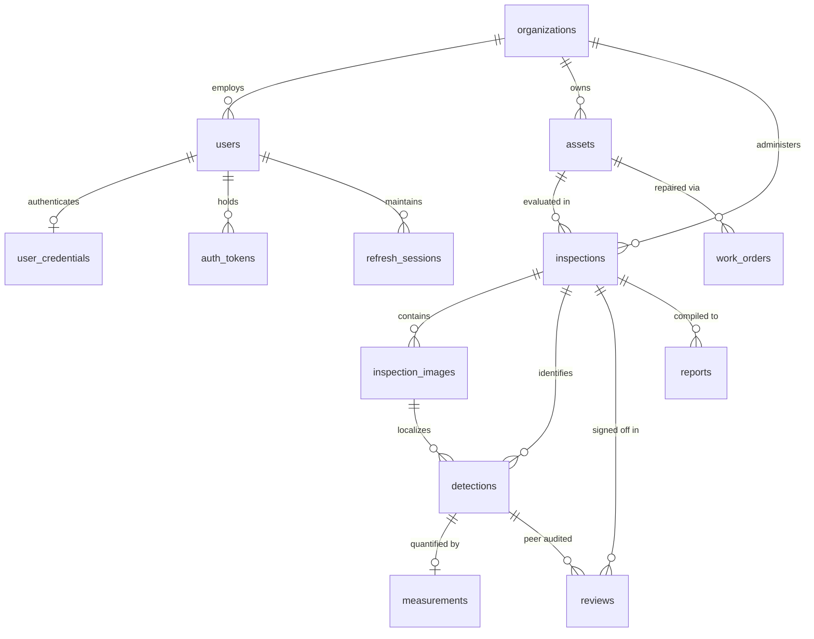

# 🏗️ InfraScan — Master Deployment & System Architecture Manual

> **Document Classification**: Engineering Master Manual  
> **Target Audience**: Systems Engineers, Site Reliability Engineers (SRE), MLOps, DevOps, Infrastructure Deployment Leads  
> **Platform Version**: InfraScan Enterprise 2.0.0  
> **Target Hardware Accelerator**: NVIDIA GeForce RTX 2050 Mobile (4.0 GB GDDR6 VRAM, Ampere GA107, 2,048 CUDA Cores, 64 Tensor Cores)  
> **Canonical Path**: `project/infosys/DEPLOYMENT_AND_ARCHITECTURE_GUIDE.md`  
> **Date of Synthesis**: November 15, 2026  

---

## 📑 Table of Contents

1. [Executive Summary & System Architecture](#1-executive-summary--system-architecture)
2. [Hardware Sizing & CUDA Acceleration Specifications](#2-hardware-sizing--cuda-acceleration-specifications)
3. [Multi-Stage AI Inference Pipeline Architecture](#3-multi-stage-ai-inference-pipeline-architecture)
4. [Step-by-Step Installation & Setup (uv & npm)](#4-step-by-step-installation--setup-uv--npm)
5. [Database Architecture & High-Concurrency SQLite WAL Engine](#5-database-architecture--high-concurrency-sqlite-wal-engine)
6. [Systemd Service Unit Configurations](#6-systemd-service-unit-configurations)
7. [Production Nginx Reverse Proxy Configuration](#7-production-nginx-reverse-proxy-configuration)
8. [Master Environment Variables Catalog](#8-master-environment-variables-catalog)
9. [Physical Directory Structure & Storage Topology](#9-physical-directory-structure--storage-topology)
10. [Exhaustive File-by-File Segment Directory](#10-exhaustive-file-by-file-segment-directory)
11. [SRE & Troubleshooting Runbook](#11-sre--troubleshooting-runbook)

---

## 1. Executive Summary & System Architecture

**InfraScan** is an enterprise-grade cyber-physical platform engineered for automated visual inspection, structural health monitoring, crack geometry quantification, and civil infrastructure damage assessment (highways, bridges, tunnels, retaining walls, dams, and marine piers).

The platform bridges the gap between field photographic acquisition and deterministic structural engineering decisions by coupling classical computer vision with a multi-stage deep neural inference cascade and strict civil engineering review governance.

### 1.1 High-Level Architecture Topology

```
+---------------------------------------------------------------------------------------------------+
|                                      CLIENT TIER (React 19 / Vite 8)                              |
|  - Field Photo Capture (Camera / Batch Drag-and-Drop)     - Split Comparison Slider (4-Way View)  |
|  - Interactive Crop & Free-Angle Canvas Rotation          - Astrix Watermelon Dashboard Suite     |
|  - 5 Role Workspaces: Inspector, Engineer, Manager, Maintenance, Administrator                    |
+-------------------------------------------------+-------------------------------------------------+
                                                  | HTTPS / WSS / REST
                                                  v
+-------------------------------------------------+-------------------------------------------------+
|                                 REVERSE PROXY & GATEWAY (Nginx)                                   |
|  - SSL/TLS Termination & HTTP/2 Hardening                 - Static SPA Routing (try_files)        |
|  - Buffer & Timeout Tuning (50MB Payload, 120s Timeout)  - Immutable Asset Cache (/storage/*)     |
+-------------------------------------------------+-------------------------------------------------+
                                                  | Reverse Proxy (127.0.0.1:8000)
                                                  v
+-------------------------------------------------+-------------------------------------------------+
|                                APPLICATION SERVER (FastAPI / ASGI)                                |
|  - Lifespan Pre-warming & CUDA Detection                  - SecurityHeaders & RequestMetrics MW   |
|  - 15 Feature Routers (212 Endpoints)                     - Argon2id & Dual JWT/Cookie Auth       |
|  - GPU Concurrency Semaphore (threading.Semaphore(1))     - ReportLab Certified PDF Sign-off      |
+------------------------+------------------------------------+-------------------------------------+
                         |                                    |
                         v                                    v
+------------------------+-------------------+  +-------------+-------------------------------------+
|        MULTI-STAGE AI INFERENCE PIPELINE   |  |        DATA PERSISTENCE & STORAGE                 |
|  0. 7-Point CV Quality Audit (Laplacian)   |  |  - SQLite 3 with Write-Ahead Logging (WAL)        |
|  1. ResNet-18 Multi-Scale Spatial Gate (80%)| |    (PRAGMA busy_timeout=60000, cache_size=-64000) |
|  2A. RF-DETR Medium Transformer (RDD2022)  |  |  - Production Fallback: PostgreSQL 16 + PostGIS   |
|  2B. YOLOv8 Crack Fallback (imgsz=768)     |  |  - Derivative Disk Storage:                       |
|  2C. UNet Semantic Segmentation (CrackSeg) |  |    /storage/uploads, /thumbnails, /processed,     |
|  2D. Mathematical Crack Geometry (EDT/PCA) |  |    /storage/rfdetr, /storage/unet, /geometry      |
|  2E. AASHTO / Scale-Invariant Severity     |  |                                                   |
+--------------------------------------------+  +---------------------------------------------------+
```

### 1.2 Core Civil Engineering Rules Enforced by System

InfraScan enforces seven non-negotiable engineering mandates across all backend services and frontend components:

1. **AI Decision Support, Never an Autonomous Verdict**: Every AI detection is strictly designated as an `ai_model` suggestion. Official engineering status is granted only after a licensed Civil Engineer conducts review and sign-off.
2. **Restricted Structural Terminology**: The platform never labels a structure as "unsafe" or "structurally condemned". The maximum automated severity designation is `Critical / Requires Urgent Engineering Review`.
3. **Pixels vs. Millimetres Calibration Gate**: When an optical reference calibration (`mm_per_pixel`) is absent, physical millimeter dimensions are never fabricated. Dimensions are explicitly output in pixels (`px`) alongside scale-invariant metrics (Surface Density %, Relative Thickness Ratio $R$) and an `Uncalibrated` badge.
4. **Visual Progression Comparison Gate**: Temporal crack growth calculation between historical inspections is restricted to verified pairs sharing identical camera viewpoints, homography feature inliers $\ge 30\%$, and valid optical calibration.
5. **Absence of Detections $\neq$ Proof of No Damage**: When an image contains no defects, the system outputs `No defects detected by AI in reviewed imagery (Sound Surface)`, never declaring the whole physical structure sound.
6. **Strict Role-Based Access Control (RBAC)**: Five discrete operational roles (Inspector, Civil Engineer, Manager, Maintenance, Admin) with enforced privilege boundaries (e.g., only Engineers sign off; Managers/Maintenance have read-only access to unreviewed images).
7. **Tamper-Evident Report Governance**: Executive reports require reviewed-only data and embed a cryptographic SHA-256 integrity hash linking the document, generating user, and underlying inspection records.

---

## 2. Hardware Sizing & CUDA Acceleration Specifications

### 2.1 Target GPU Architecture: NVIDIA GeForce RTX 2050 Mobile

The InfraScan AI runtime is optimized specifically to exploit low-power, entry-level edge workstation GPUs, benchmarked on the **NVIDIA GeForce RTX 2050 Mobile**:

| Architectural Parameter | Specification Value |
| :--- | :--- |
| **GPU Microarchitecture** | NVIDIA Ampere (GA107) |
| **CUDA Cores** | 2,048 Cores |
| **Tensor Cores** | 64 (3rd Generation Tensor Cores) |
| **Base / Boost Clock** | 1,185 MHz / 1,477 MHz |
| **Total Physical VRAM** | 4,096 MB (4.0 GB GDDR6) |
| **Memory Bus Width** | 64-bit |
| **Memory Bandwidth** | Up to 112.0 GB/s |
| **Target Driver Version** | Linux: `>= 535.183.01` \| Windows: `>= 551.61` |
| **Target CUDA Runtime** | CUDA 12.8 / CUDA 12.4 (`cu128` wheel) |
| **cuDNN Version** | cuDNN 9.x |

### 2.2 System Host Minimum & Recommended Specifications

| Subsystem | Minimum Specification | Recommended Production Specification |
| :--- | :--- | :--- |
| **CPU** | 4 Cores / 8 Threads x86_64 (e.g. Intel Core i5 11th Gen / AMD Ryzen 5) | 8 Cores / 16 Threads (Intel Core i7 13th Gen / AMD Ryzen 7) |
| **System RAM** | 16 GB DDR4 3200MHz | 32 GB DDR5 4800MHz |
| **Dedicated GPU** | NVIDIA RTX 2050 4GB VRAM | NVIDIA RTX 2050 / RTX 3060 / RTX 4060 (>= 4GB VRAM) |
| **Storage Subsystem** | 50 GB NVMe PCIe 3.0 SSD (Read $\ge 2000$ MB/s) | 250 GB NVMe PCIe 4.0 SSD (Read $\ge 5000$ MB/s) |
| **Operating System** | Ubuntu 22.04 LTS / Windows 11 64-bit | Ubuntu 24.04 LTS (Server or Desktop) |
| **Network Interface** | 1 Gbps Ethernet | 2.5 Gbps or 10 Gbps Ethernet |

### 2.3 Measured VRAM Footprint & GPU Concurrency Budget

Because 4GB VRAM is a constrained memory ceiling, InfraScan employs an intelligent static residency strategy. The four deep neural models have a combined static weight footprint of only **254.09 MB**, enabling all four models to reside in VRAM simultaneously without thrashing disk I/O.

```
Total RTX 2050 VRAM: 4,096 MB (100.0%)
+---------------------------------------------------------------------------------------------------+
| Static Weights | Runtime Activation Buffers |                Available Headroom                   |
|    254.1 MB    |        ~240.0 MB           |                    3,601.9 MB                       |
|     (6.2%)     |          (5.9%)            |                     (87.9%)                         |
+----------------+----------------------------+-----------------------------------------------------+
```

| Pipeline Component | Weight File | Static VRAM | Active Precision | Execution Provider |
| :--- | :--- | :--- | :--- | :--- |
| **ResNet-18 Classifier** | `infrascan_crack_resnet18_torchscript.pt` | **42.69 MB** | FP32 | TorchScript JIT on `cuda:0` |
| **RF-DETR Medium** | `rdd2022_rfdetr_medium_best.pth` | **193.70 MB** | FP16 | PyTorch native FP16 Tensor Cores |
| **YOLOv8 Localizer** | `infrascan_yolo_v1_2_crack_best.pt` | **10.25 MB** | FP16 / FP32 | Ultralytics CUDA engine on `cuda:0` |
| **UNet Segmentor** | `infrascan_unet_crackseg9k_best.pth` | **7.45 MB** | FP16 | `torch.autocast("cuda", torch.float16)` |
| **Total Static Footprint** | — | **254.09 MB** | — | **All 4 models resident simultaneously** |
| **Peak Inference Buffers** | Dynamic tensor allocations | **~180–240 MB** | Mixed | Batch size = 1 stream |
| **Total Peak GPU Allocation** | — | **~450–500 MB** | — | **< 12.5% of 4.0 GB VRAM** |
| **Available VRAM Headroom** | — | **~3,596 MB** | — | **87.5% safety cushion against OOM** |

### 2.4 GPU Concurrency Semaphore Lock

To prevent multi-threaded HTTP requests from flooding the GPU and causing CUDA out-of-memory (OOM) faults on 4GB VRAM, `apps/api/app/routers/upload.py` implements an explicit serialization semaphore:

```python
import threading

# GPU Semaphore to prevent multiple concurrent threads thrashing 4GB VRAM
gpu_inference_lock = threading.Semaphore(1)
```

During batch upload or interactive transformation:
```python
with gpu_inference_lock:
    # 1. ResNet-18 multi-scale evaluation
    # 2. RF-DETR primary inference
    # 3. YOLOv8 fallback (if required)
    # 4. UNet semantic segmentation
```
This guarantees that while CPU operations (I/O, CLAHE, skeleton graph traversal) run concurrently across multiple threads, GPU tensor calculations are strictly serialized, ensuring zero OOM crashes.

---

## 3. Multi-Stage AI Inference Pipeline Architecture

InfraScan replaces brittle single-model object detection with an end-to-end, 5-stage inference cascade:

```
[Raw Photo Upload]
       │
       ▼
[Stage 0: 7-Point Classical CV Quality Audit]
       │
       ├─── Failed (Blur < 30 / Light < 40 / Corrupt) ──► [HTTP 400 / Quality Rejection Notice]
       │
       ▼
[Stage 0 Preprocessing: CLAHE, Bilateral Filter, Unsharp Mask, Tiling]
       │
       ▼
[Stage 1: ResNet-18 Multi-Scale Spatial Classifier (4 Crops)]
       │
       ├─── Crack Probability < 80.0% ──► [Sound Concrete Surface] (Exit early, zero detections)
       │
       └─── Crack Probability >= 80.0%
                │
                ▼
       [Stage 2A: RF-DETR Medium Defect Detector (RDD2022)]
                │
                ├─── Defect Detections > 0 ──► [Primary Defect Assigned (D00/D10/D20/D40)]
                │                                     │
                └─── Defect Detections == 0           │
                         │                            │
                         ▼                            │
                [Stage 2B: YOLOv8 Fallback]           │
                         │                            │
                         ▼                            ▼
       [Stage 2C: UNet Pixel-Level Crack Segmentation (CrackSeg9k)]
                │ (Produces High-Resolution Sigmoid Binary Mask)
                ▼
       [Stage 2D: Deterministic Crack Geometry Extraction Engine]
                │ - Medial Axis Skeletonization & 8-Connected Traversal (1.0 vs sqrt(2))
                │ - Euclidean Distance Transform (L2) Continuous Width Profiling
                │ - Principal Component Analysis (PCA) Orientation Vector in [0, 180 deg)
                │ - Branch Point Junction Detection (degree >= 3)
                ▼
       [Stage 2E: Civil Damage Severity Assessment Engine]
                │ - Mode A: Calibrated AASHTO / ASTM C856 Physical Width (mm)
                │ - Mode B: Uncalibrated Scale-Invariant Surface Density % & Ratio R
                │ - Action Window: P1 (Urgent 24-48h) to P5 (Routine Monitoring)
                ▼
       [Persistence: Unified Detection & Measurement Records in DB + Derivative Overlays]
```

### 3.1 Stage 0: Classical Computer Vision Quality Audit (`image_quality.py`)

Every image is subjected to 7 automated OpenCV tests prior to model ingestion:

1. **Magic Byte Format Check**: Validates file header signatures for JPEG (`\xff\xd8\xff`), PNG (`\x89PNG`), TIFF (`II*\x00` or `MM\x00*`), WEBP (`RIFF....WEBP`), and BMP (`BM`).
2. **File Size Enforcement**: Strict maximum threshold of $50\text{ MB}$ (`settings.MAX_FILE_SIZE_MB`).
3. **Integrity & Completeness Check**: Verifies decoding via PIL `raw.verify()` and checks image standard deviation variation $\sigma \ge 8.0$ to reject uniform black/white sensor washouts.
4. **Resolution Standardization**: Normalizes image long dimension to $\le 2048\text{ px}$ (`settings.PROCESSED_MAX_SIDE`).
5. **Blur Detection (Laplacian Variance)**:
   $$\sigma^2 = \text{Var}\left(\nabla^2 I_{1024}\right)$$
   - $\sigma^2 < 30.0$: **Rejection Fail** (Image discarded as completely blurred).
   - $30.0 \le \sigma^2 < 80.0$: **Quality Warning** (Soft focus; sharpening bypassed in preprocessing to prevent halo artifacts).
   - $\sigma^2 \ge 80.0$: **Pass** (Sharp image focus confirmed).
6. **Illumination Assessment (Mean Luminance)**:
   $$Y = 0.299R + 0.587G + 0.114B$$
   - $Y < 40.0$: **Rejection Fail** (Underexposed/pitch-black capture).
   - $40.0 \le Y < 70.0$: **Warning** (Low light; automated non-linear gamma brightening triggered).
   - $Y \ge 70.0$: **Pass** (Adequate surface lighting).
7. **Perceptual Duplicate Detection (pHash)**:
   - Computes a 64-bit DCT perceptual hash.
   - Exact SHA-256 duplicate within same inspection: `fail`.
   - pHash Hamming Distance $\le 5$ bits against existing asset photos: `warning` (flags duplicate angle).

### 3.2 Classical Enhancement & Preprocessing

- **LAB CLAHE**: Contrast-Limited Adaptive Histogram Equalization applied to the L-channel ($\text{clipLimit}=2.0, \text{grid}=(8,8)$) when surface luminance standard deviation is flat ($<55.0$).
- **Bilateral Filtering**: Noise reduction ($d=5, \sigma_{\text{color}}=30, \sigma_{\text{space}}=30$) suppressing sensor noise while preserving structural crack boundaries.
- **Gray-World Normalization**: Compensates for harsh sodium or mercury ambient lighting when chromatic delta exceeds $18.0$.
- **High-Resolution Drone Tiling**: If $\max(W, H) > 4096\text{ px}$, computes a grid of $1024 \times 1024\text{ px}$ tiles with $20\%$ overlap.

### 3.3 Stage 1: ResNet-18 Binary Crack Classifier (`classifier.py`)

- **Strict 80% Defect Cutoff**: To eliminate false alarms on sound concrete, an image is declared cracked **only if** $P(\text{Crack}) \ge 0.80$.
- **4-Patch Multi-Scale Spatial Inspection**: Hairline cracks can be lost when a 12MP photo is downsampled to $224 \times 224$. The classifier evaluates 4 crops:
  1. *Global*: Full photograph downscaled to $224 \times 224$.
  2. *Center Focus*: Bounding crop $[0.12W, 0.12H, 0.88W, 0.88H]$.
  3. *Horizontal Band*: Crop $[0, 0.20H, W, 0.80H]$.
  4. *Vertical Band*: Crop $[0.20W, 0, 0.80W, H]$.
  $$P(\text{Crack}) = \max(P_{\text{global}}, P_{\text{center}}, P_{\text{horiz}}, P_{\text{vert}})$$
- **Early Exit on Sound Surfaces**: If $P(\text{Crack}) < 0.80$, the system classifies the surface as `Sound Concrete Surface (No Visible Damage)`, generates zero detections, sets severity to `Routine Maintenance`, and bypasses all downstream Stage 2 models.

### 3.4 Stage 2A & 2B: Defect Detection & Fallback Cascade

- **Primary Detector (RF-DETR Medium)**: Transformer-based object detector trained on RDD2022 with DINOv2 backbone. Detects 4 classes:
  - `D00`: Longitudinal Crack (Amber `#F59E0B`)
  - `D10`: Transverse Crack (Cyan `#0EA5E9`)
  - `D20`: Alligator Crack (Crimson `#EF4444`)
  - `D40`: Pothole / Spalling (Purple `#A855F7`)
- **Automated Fallback (YOLOv8)**: If RF-DETR returns 0 detections on an image confirmed as cracked by Stage 1 ResNet-18, the system immediately invokes fine-tuned YOLOv8 (`infrascan_yolo_v1_2_crack_best.pt`, $768\text{ px}$) with dual sensitivity passes (`conf=0.10` followed by `conf=0.04`).

### 3.5 Stage 2C: UNet Pixel-Level Crack Segmentation (`unet_segmentor.py`)

- **Architecture**: 4-stage encoder-decoder with `DoubleConv` blocks and skip connections, trained on `CrackSeg9k`.
- **Validation Metrics**: Dice Score: $75.14\%$, IoU: $60.18\%$, Pixel Accuracy: $97.44\%$.
- **Inference**: Evaluated at $384 \times 384$ with FP16 autocast, then bilinearly interpolated back to full image resolution.
- **Mask & Overlays**:
  - Binary Mask thresholded at sigmoid probability $\tau \ge 0.50$, saved to `storage/unet/{id}_mask.png`.
  - Neon Crimson Overlay ($R=239, G=68, B=68, \alpha=0.45$) with cyan boundary contours, saved to `storage/unet/{id}.jpg`.
  - Inspector Dashboard card thumbnail dynamically points to this U-Net overlay for cracked photos.

### 3.6 Stage 2D: Deterministic Mathematical Crack Geometry Engine (`crack_geometry.py`)

Operates directly on the binary mask to derive certified engineering dimensions:

1. **Skeletonization**: Morphological medial axis thinning (`skimage.morphology.skeletonize`) reduces cracks to 1-pixel centerlines.
2. **Graph Centerline Length Integration**: Traverses the 8-connected skeleton graph:
   - Orthogonal step: adds $1.0\text{ px}$.
   - Diagonal step: adds $\sqrt{2} \approx 1.4142\text{ px}$.
3. **Euclidean Distance Transform (EDT) Thickness**: Computes `cv2.distanceTransform(comp_mask, cv2.DIST_L2, 5)`. Local width is $w(x, y) = 2 \times \text{EDT}(x, y)$. Computes average, median, and maximum crack width.
4. **Principal Component Analysis (PCA) Orientation**:
   Diagonalizes the covariance matrix of crack coordinates:
   $$\theta = \left(\arctan2(v_y, v_x) \times \frac{180}{\pi}\right) \pmod{180}$$
   - $0^\circ \le \theta \le 25^\circ$ or $155^\circ \le \theta < 180^\circ$: Transverse (Horizontal)
   - $65^\circ \le \theta \le 115^\circ$: Longitudinal (Vertical)
   - Otherwise: Diagonal / Oblique
5. **Topological Branch Detection**: Skeleton nodes with degree $\ge 3$ are flagged as branch points. $\ge 4$ junctions reclassifies the defect as an Alligator fatigue network.

### 3.7 Stage 2E: Damage Severity & Maintenance Priority Appraisal (`damage_assessment.py`)

Conforms to AASHTO / ASTM C856 standards across two operational modes:

#### Mode A: Calibrated Physical Scale (mm)
Activated when `mm_per_pixel` is provided via fiduciary markers or laser telemetry:

| Severity Level | Peak Width ($W_{\max}$) | Crack Surface Density | Branch Count | Priority Code | Action Window & Engineering Protocol |
| :--- | :--- | :--- | :--- | :--- | :--- |
| **No Visible Damage** | $0.0\text{ mm}$ | $0.0\%$ | $0$ | `routine_monitoring` | Standard annual inspection cycle. |
| **Minor (Hairline)** | $< 3.0\text{ mm}$ | $< 2.0\%$ | $< 5$ | `low` | Preventative monitoring; surface sealant in next cycle. |
| **Moderate** | $3.0\text{ mm} \le W \le 5.0\text{ mm}$ | $2.0\% \le \text{Density} \le 5.0\%$ | $< 10$ | `medium` | Scheduled crack sealing / epoxy injection (60–90 days). |
| **Severe** | $> 5.0\text{ mm} \text{ to } 8.0\text{ mm}$ | $5.0\% \le \text{Density} \le 9.0\%$ | $> 10$ | `high` | Structural inspection and repair scheduling (14–30 days). |
| **Critical** | $> 8.0\text{ mm}$ | $> 9.0\%$ | $> 50$ | `urgent_engineering_review` | Immediate structural engineer review (24–48 hours); traffic restrictions. |

#### Mode B: Uncalibrated Scale-Invariant Mode
When optical calibration is absent, the system evaluates:
- **Surface Crack Density %**: $\frac{\text{Crack Area (px)}}{\text{Inspected Surface Area (px)}} \times 100\%$
- **Relative Thickness Ratio ($R$)**: $R = \frac{W_{\max\text{ (px)}}}{\min(W_{\text{img}}, H_{\text{img}})}$

| Severity Level | Surface Crack Density | Relative Thickness Ratio $R$ | Branch Junctions | Structural Description |
| :--- | :--- | :--- | :--- | :--- |
| **Minor Damage** | $< 0.5\%$ | $R < 0.015$ ($< 1.5\%$ of frame) | $< 5$ | Superficial / hairline fissure |
| **Moderate Damage** | $0.5\% \le \text{Density} < 2.5\%$ | $0.015 \le R < 0.045$ ($1.5\% - 4.5\%$) | $< 10$ | Moderate concrete distress |
| **Severe Damage** | $2.5\% \le \text{Density} \le 9.0\%$ | $0.045 \le R < 0.090$ ($4.5\% - 9.0\%$) | $> 10$ | Deep interconnected fatigue network |
| **Critical Damage** | $> 9.0\%$ | $R \ge 0.090$ ($\ge 9.0\%$ of frame) | $> 50$ | Advanced structural disintegration |

*Morphological Escalation*: Photos with detected **Exposed Reinforcing Steel (Rebar)** or **Active Concrete Spalling** automatically escalate to `Critical` severity regardless of crack width.

### 3.8 Stage 2F: Explainable AI (XAI) & Visual Attribution Engine (`explainable_ai.py`)

To ensure civil engineers can audit, defend, and verify why deep neural networks declared an infrastructure defect, InfraScan embeds an automated Explainable AI (XAI) Engine adhering to PDF Section 12 (Page 15) and Section 18 (Page 21):

```
+---------------------------------------------------------------------------------------------------+
|                            5-WAY UNIFIED VISUAL EXPLANATION STRIP                                 |
|                                                                                                   |
|  [ 1. Original Image ] ──► [ 2. Defect Detection ] ──► [ 3. U-Net Mask ]                          |
|         Raw Photo            RF-DETR / YOLO Box        Crimson 45% Alpha                          |
|                                                                                                   |
|                                ──► [ 4. AI Attention Map ] ──► [ 5. Damage Assessment ]           |
|                                      Grad-CAM++ Heatmap           AASHTO Severity & Action        |
+---------------------------------------------------------------------------------------------------+
```

#### Visual Explanation Modalities:
1. **Grad-CAM (Gradient-Weighted Class Activation Mapping)**:
   Computes activation gradients flowing into the final convolutional layer of ResNet-18 (`layer4[1].conv2`):
   $$\alpha_k^c = \frac{1}{Z} \sum_{i} \sum_{j} \frac{\partial Y^c}{\partial A_{i, j}^k}, \quad L_{\text{Grad-CAM}}^c = \text{ReLU}\left(\sum_k \alpha_k^c A^k\right)$$
2. **Grad-CAM++**:
   Incorporates second- and third-order positive partial derivatives, delivering superior localization for multiple fine hairline crack branches within the same structural member.
3. **Spatial Feature Attention Maps**:
   Evaluates cross-channel energy activation norms ($L_2$ norm along channel axis $C$) independent of classification gradients, highlighting all structural discontinuities.
4. **Input Saliency Maps**:
   Computes vanilla input-space pixel attributions via $\left|\nabla_x Y^c\right|$, revealing individual edge boundaries influencing the prediction.

#### Runtime Engineering & Concurrency:
- **Device & Backward Hook Locks**: PyTorch backward graph passes are executed within a dedicated mutex (`_XAI_LOCK = threading.Lock()`) to prevent race conditions during forward/backward hook execution.
- **Dynamic Colormap Synthesis**: Heatmaps are normalized to $[0, 1]$, colorized via OpenCV (`COLORMAP_TURBO`, `COLORMAP_JET`, `COLORMAP_PLASMA`, `COLORMAP_VIRIDIS`, `COLORMAP_INFERNO`), and composited onto original photographs.
- **REST API Endpoints**:
  - `GET /api/v1/images/{image_id}/xai`: Returns structured XAI metadata, target class, confidence, top decision factors, and variant image URLs.
  - `GET /api/v1/images/{image_id}/xai?variant={gradcam|gradcam_pp|attention|saliency}&colormap={turbo|jet|plasma}`: Streams on-demand blended visual heatmaps.
- **Interactive UI Integration**:
  Rendered in the right sidebar drawer (`ImageDetailsDrawer` in `image-quality-components.tsx`) under the **Explainable AI** tab with an interactive opacity slider ($0\%-100\%$), colormap picker, and multi-model explainability correlation matrix.

---

## 4. Step-by-Step Installation & Setup (uv & npm)

Follow these exact steps to deploy InfraScan on Linux (Ubuntu 22.04/24.04 LTS) or Windows 11.

### 4.1 System Prerequisites

```bash
# Ubuntu Linux Prerequisites
sudo apt-get update && sudo apt-get install -y \
    build-essential \
    curl \
    git \
    libgl1-mesa-glx \
    libglib2.0-0 \
    python3-dev \
    nginx
```

Verify NVIDIA driver and CUDA availability:
```bash
nvidia-smi
```

### 4.2 Python Environment Setup with `uv`

In accordance with workspace rules, always use `uv` for dependency resolution and execution:

```bash
# 1. Install uv (if not already installed)
curl -LsSf https://astral.sh/uv/install.sh | sh
# On Windows PowerShell:
# powershell -ExecutionPolicy ByPass -c "irm https://astral.sh/uv/install.ps1 | iex"

# 2. Clone or navigate to the repository
cd "/d/project/aiml prime"   # or "D:\project\aiml prime" on Windows

# 3. Create dedicated virtual environment with Python 3.12
uv venv .venv --python 3.12

# 4. Synchronize dependencies from pyproject.toml including PyTorch CUDA 12.8
uv pip install -r pyproject.toml --extra-index-url https://download.pytorch.org/whl/cu128
```

Verify CUDA hardware acceleration inside the virtual environment:
```powershell
& "D:\project\aiml prime\.venv\Scripts\python.exe" -c "import torch; print(f'CUDA Available: {torch.cuda.is_available()}, Device: {torch.cuda.get_device_name(0) if torch.cuda.is_available() else \"None\"}')"
# Output should confirm: CUDA Available: True, Device: NVIDIA GeForce RTX 2050
```

### 4.3 Model Weights Placement

Ensure all trained model weights are located in `storage/models`:
```
storage/models/
├── infrascan_crack_resnet18_torchscript.pt  (44.89 MB)
├── infrascan_crack_resnet18.onnx            (44.70 MB)
├── infrascan_crack_resnet18_weights.pth     (44.79 MB)
├── rdd2022_rfdetr_medium_best.pth           (133.72 MB)
├── infrascan_yolo_v1_2_crack_best.pt        (26.62 MB)
├── infrascan_unet_crackseg9k_best.pth       (7.82 MB)
├── model_metadata.json                      (800 bytes)
└── model_metadata_resnet18.json             (693 bytes)
```

Test model initialization:
```powershell
cd "D:\project\aiml prime\project\infosys\apps\api"
& "D:\project\aiml prime\.venv\Scripts\python.exe" -c "
from app.services.classifier import get_classifier
from app.services.rfdetr_detector import get_rfdetr_detector
from app.services.yolo_detector import get_yolo_detector
from app.services.unet_segmentor import get_unet_segmentor

print('ResNet-18:', get_classifier().is_loaded)
print('RF-DETR:  ', get_rfdetr_detector().is_loaded)
print('YOLOv8:   ', get_yolo_detector().is_loaded)
print('UNet:     ', get_unet_segmentor().is_loaded)
"
```

### 4.4 Database Bootstrap & First Administrator Creation

```powershell
cd "D:\project\aiml prime\project\infosys\apps\api"

# 1. Seed reference categories (defect taxonomy, severity levels, priority rules)
& "D:\project\aiml prime\.venv\Scripts\python.exe" -m app.cli seed

# 2. Import benchmark EDA dataset records
& "D:\project\aiml prime\.venv\Scripts\python.exe" -m app.cli import-eda

# 3. Create the initial lead administrator account
& "D:\project\aiml prime\.venv\Scripts\python.exe" -m app.cli create-admin --email admin@infrascan.local --name "Lead Administrator"
# Follow prompt to set password (minimum 12 characters)
```

### 4.5 Frontend Installation & Production Build with `npm`

```bash
cd "project/infosys/frontend"

# 1. Install Node.js dependencies
npm install

# 2. Run unit tests to verify compliance
npm test

# 3. Run typecheck and production build
npm run build
# Output will be generated in project/infosys/frontend/dist/
```

---

## 5. Database Architecture & High-Concurrency SQLite WAL Engine

InfraScan supports a dual-mode persistence architecture:
1. **Local Edge & Single-Node Workstation**: SQLite with Write-Ahead Logging (WAL) and memory optimization PRAGMAs.
2. **Enterprise Multi-Node Cluster**: PostgreSQL 16 + PostGIS (configured via `DATABASE_URL=postgresql+asyncpg://...`).

### 5.1 SQLite WAL Engine Optimization PRAGMAs

In `apps/api/app/database.py`, SQLite connections are configured with kernel-level PRAGMAs executed on every connection event:

```python
from sqlalchemy import event

@event.listens_for(engine, "connect")
def set_sqlite_pragma(dbapi_connection, connection_record):
    if settings.DATABASE_URL.startswith("sqlite"):
        try:
            cursor = dbapi_connection.cursor()
            cursor.execute("PRAGMA journal_mode=WAL")
            cursor.execute("PRAGMA synchronous=NORMAL")
            cursor.execute("PRAGMA busy_timeout=60000")
            cursor.execute("PRAGMA cache_size=-64000")
            cursor.execute("PRAGMA temp_store=MEMORY")
            cursor.close()
        except Exception:
            pass
```

#### Engineering Justification for PRAGMA Settings:
- `PRAGMA journal_mode=WAL`: Enables Write-Ahead Logging. Readers never block writers, and writers never block readers. Creates the `-wal` and `-shm` companion files.
- `PRAGMA synchronous=NORMAL`: Syncs to disk only at critical WAL checkpoints. Delivers a $5\times-10\times$ write throughput speedup while maintaining ACID guarantees on standard filesystem crashes.
- `PRAGMA busy_timeout=60000`: Sets the internal lock acquisition timeout to **60,000 milliseconds (60 seconds)**. Prevents immediate `sqlite3.OperationalError: database is locked` failures when concurrent background tasks write simultaneously.
- `PRAGMA cache_size=-64000`: Allocates **64 MB of dedicated RAM page cache** per connection (negative integer denotes kibibytes), keeping hot index b-trees in RAM.
- `PRAGMA temp_store=MEMORY`: Keeps all temporary tables, sorting buffers, and intermediate query b-trees in RAM rather than thrashing disk I/O.

### 5.2 Automated Schema Migrations (`ensure_schema_upgrades`)

On application startup, `app/database.py` executes `ensure_schema_upgrades(engine)` to inspect existing SQLite/PostgreSQL tables using `PRAGMA table_info` and safely inject missing columns with default values:
- `assets`: `region VARCHAR(128) DEFAULT 'Central'`
- `inspections`: `method`, `analysis_status`, `claimed_by`, `claimed_at`, `submitted_at`, `reviewed_at`, `previous_inspection_id`
- `inspection_images`: `quality_status`, `processing_status`, `warning_confirmed_by`, `warning_confirmed_at`
- `notifications`: `alert_level`, `entity_type`, `entity_id`

### 5.3 Catalog of 35 Data Models

The relational schema is structured into 7 functional domains in `app/models/all_models.py`:



1. **Identity & Governance**: `Organization`, `User`, `UserCredential`, `AuthToken`, `RefreshSession`, `Invitation`, `AuditLog`, `RequestMetric`, `SetupState`.
2. **Defect & Engineering Nomenclature**: `DefectType`, `SeverityLevel`, `PriorityCategory`, `InfrastructureType`, `AlertLevel`.
3. **Asset & Field Operations**: `Asset`, `Inspection`, `InspectionImage`, `ImageQualityReport`, `ImageProcessingRun`, `ProcessedImage`, `Notification`.
4. **Benchmark Datasets**: `Dataset`, `DatasetInspectionStat`, `DatasetClassStat`.
5. **Findings & Measurements**: `Detection`, `Measurement`, `Review`, `PriorityRecommendation`.
6. **Engineering Rules**: `SeverityRule`, `PriorityRule`, `RepairTaskTemplate`.
7. **Maintenance & Reports**: `WorkOrder`, `WorkOrderEvent`, `InspectionComparison`, `Report`.

---

## 6. Systemd Service Unit Configurations

For production deployments on Ubuntu 22.04/24.04 LTS, register the API Gateway and frontend services under `systemd`.

### 6.1 Backend API Service (`/etc/systemd/system/infrascan-api.service`)

```ini
[Unit]
Description=InfraScan FastAPI Civil Infrastructure API Gateway
After=network.target

[Service]
Type=simple
User=infrascan
Group=infrascan
WorkingDirectory=/opt/infrascan/project/infosys/apps/api
EnvironmentFile=/opt/infrascan/project/infosys/.env
Environment="PATH=/opt/infrascan/.venv/bin:/usr/local/cuda/bin:/usr/bin"
Environment="CUDA_VISIBLE_DEVICES=0"
Environment="TORCH_HOME=/opt/infrascan/storage/models"

ExecStart=/opt/infrascan/.venv/bin/uvicorn app.main:app \
    --host 127.0.0.1 \
    --port 8000 \
    --workers 1 \
    --lifespan on \
    --access-log \
    --timeout-keep-alive 65

Restart=always
RestartSec=5s

# Security sandboxing
NoNewPrivileges=true
ProtectSystem=full
ProtectHome=read-only
ReadWritePaths=/opt/infrascan/project/infosys/apps/api /opt/infrascan/project/infosys/storage /opt/infrascan/project/infosys/uploads

# Resource limits
LimitNOFILE=65536
LimitNPROC=4096

[Install]
WantedBy=multi-user.target
```

> [!IMPORTANT]
> **Worker Count Configuration**: Notice `--workers 1`. Because the target machine uses an entry-level GPU (RTX 2050 4GB), running multiple Uvicorn worker processes would instantiate multiple PyTorch CUDA contexts, instantly exhausting the 4GB VRAM. A single asynchronous worker with the internal `gpu_inference_lock = threading.Semaphore(1)` delivers maximum throughput without OOM errors.

### 6.2 Systemd Commands Runbook

```bash
# 1. Copy service file and set permissions
sudo cp infrascan-api.service /etc/systemd/system/
sudo chmod 644 /etc/systemd/system/infrascan-api.service

# 2. Reload systemd daemon
sudo systemctl daemon-reload

# 3. Enable service on boot and start
sudo systemctl enable infrascan-api.service
sudo systemctl start infrascan-api.service

# 4. Check status and health
sudo systemctl status infrascan-api.service

# 5. Monitor real-time logs
journalctl -u infrascan-api.service -f -n 100
```

---

## 7. Production Nginx Reverse Proxy Configuration

Nginx serves the compiled React 19 frontend as static assets, handles SSL/TLS termination, routes `/api/` traffic to FastAPI, enforces the 50MB upload limit, and sets long timeouts for multi-stage AI inference.

### 7.1 Site Configuration (`/etc/nginx/sites-available/infrascan.conf`)

```nginx
# Upstream definition for FastAPI ASGI Gateway
upstream infrascan_api {
    server 127.0.0.1:8000 fail_timeout=0;
    keepalive 32;
}

# HTTP Redirection to HTTPS
server {
    listen 80;
    listen [::]:80;
    server_name infrascan.local inspection.authority.gov;
    return 301 https://$host$request_uri;
}

# HTTPS Main Server Block
server {
    listen 443 ssl http2;
    listen [::]:443 ssl http2;
    server_name infrascan.local inspection.authority.gov;

    # SSL / TLS Hardening
    ssl_certificate /etc/ssl/certs/infrascan.crt;
    ssl_certificate_key /etc/ssl/private/infrascan.key;
    ssl_protocols TLSv1.2 TLSv1.3;
    ssl_ciphers ECDHE-ECDSA-AES128-GCM-SHA256:ECDHE-RSA-AES128-GCM-SHA256:ECDHE-ECDSA-AES256-GCM-SHA384:ECDHE-RSA-AES256-GCM-SHA384;
    ssl_prefer_server_ciphers off;
    ssl_session_cache shared:SSL:10m;
    ssl_session_timeout 1d;
    ssl_session_tickets off;

    # Root directory pointing to Vite production build
    root /opt/infrascan/project/infosys/frontend/dist;
    index index.html;

    # Upload Limit (Matches Settings.MAX_FILE_SIZE_MB = 50)
    client_max_body_size 50M;

    # Client body buffer size
    client_body_buffer_size 16M;

    # Gzip Compression
    gzip on;
    gzip_vary on;
    gzip_proxied any;
    gzip_comp_level 6;
    gzip_types text/plain text/css text/xml application/json application/javascript application/xml+rss application/atom+xml image/svg+xml;

    # Security Headers
    add_header X-Content-Type-Options "nosniff" always;
    add_header X-Frame-Options "DENY" always;
    add_header Referrer-Policy "strict-origin-when-cross-origin" always;
    add_header Content-Security-Policy "default-src 'self'; script-src 'self' 'unsafe-inline'; style-src 'self' 'unsafe-inline' https://fonts.googleapis.com; font-src 'self' https://fonts.gstatic.com data:; img-src 'self' data: blob: https://*.tile.openstreetmap.org; connect-src 'self' https://* http://*;" always;

    # 1. Frontend Single Page Application Routing
    location / {
        try_files $uri $uri/ /index.html;
        expires -1;
        add_header Cache-Control "no-store, no-cache, must-revalidate";
    }

    # 2. Immutable Frontend Static Assets (Vite hashes)
    location /assets/ {
        expires 1y;
        add_header Cache-Control "public, max-age=31536000, immutable";
        access_log off;
    }

    # 3. Direct Derivative Image Serving (/storage/ with Cache Busting)
    location /storage/ {
        alias /opt/infrascan/project/infosys/storage/;
        expires 7d;
        add_header Cache-Control "public, max-age=604800";
        try_files $uri =404;
    }

    # 4. Reverse Proxy for Backend API Gateway
    location ~ ^/(api|docs|redoc|openapi.json) {
        proxy_pass http://infrascan_api;
        proxy_http_version 1.1;

        # WebSocket / Connection upgrade support
        proxy_set_header Upgrade $http_upgrade;
        proxy_set_header Connection "upgrade";

        # Standard Forwarded Headers
        proxy_set_header Host $host;
        proxy_set_header X-Real-IP $remote_addr;
        proxy_set_header X-Forwarded-For $proxy_add_x_forwarded_for;
        proxy_set_header X-Forwarded-Proto $scheme;

        # Timeout settings for heavy AI multi-stage inference & drone pyramid tiling
        proxy_connect_timeout 120s;
        proxy_send_timeout 120s;
        proxy_read_timeout 120s;

        # Proxy Buffering
        proxy_buffering on;
        proxy_buffer_size 128k;
        proxy_buffers 4 256k;
        proxy_busy_buffers_size 256k;
    }

    # Deny access to hidden files (.env, .git)
    location ~ /\. {
        deny all;
        access_log off;
        log_not_found off;
    }
}
```

Enable the configuration:
```bash
sudo ln -s /etc/nginx/sites-available/infrascan.conf /etc/nginx/sites-enabled/
sudo nginx -t
sudo systemctl reload nginx
```

---

## 8. Master Environment Variables Catalog

All operational settings are parsed by `apps/api/app/config.py` from the root `.env` file (`project/infosys/.env`).

| Environment Variable | Type | Default Value | Production Requirement | Description |
| :--- | :--- | :--- | :--- | :--- |
| `ENVIRONMENT` | `str` | `"development"` | Set to `"production"` | Runtime operational mode (`development`, `staging`, `production`). |
| `APP_BASE_URL` | `str` | `"http://localhost:5173"` | `"https://infrascan.local"` | Frontend origin for CORS whitelist and verification emails. |
| `API_BASE_URL` | `str` | `"http://localhost:8000"` | `"https://infrascan.local/api"` | Canonical public URL of the API gateway. |
| `SUPPORT_EMAIL` | `str` | `"support@infrascan.local"` | Operational helpdesk address | Displayed on error dialogs and email footers. |
| `JWT_SECRET` | `str` | *Auto-generated hex* | **Required Secure Secret** | 64-character hex secret for signing HS256 access tokens. |
| `JWT_ALGORITHM` | `str` | `"HS256"` | `"HS256"` | Symmetric token signing algorithm. |
| `ACCESS_TOKEN_EXPIRE_MINUTES` | `int` | `15` | `15` | Lifetime of short-lived JWT access tokens in memory. |
| `REFRESH_TOKEN_EXPIRE_DAYS` | `int` | `7` | `7` | Maximum lifetime of rotating refresh sessions. |
| `COOKIE_SECURE` | `bool` | `False` | **Must be `True`** | Enforces the `Secure` flag on HttpOnly authentication cookies. |
| `COOKIE_SAMESITE` | `str` | `"lax"` | `"lax"` | Cross-site cookie policy (`lax`, `strict`). |
| `DATABASE_URL` | `str` | `sqlite:///.../infrascan_dev.db` | SQLite WAL URI or Postgres | Database connection string. |
| `SMTP_HOST` | `str` | `"localhost"` | Production SMTP relay | Outbound mail server hostname. |
| `SMTP_PORT` | `int` | `1025` | `587` or `465` | Outbound mail server port (1025 for Mailpit in dev). |
| `SMTP_USER` | `str` | `None` | SMTP username | Authentication user for transactional emails. |
| `SMTP_PASSWORD` | `str` | `None` | SMTP password | Authentication password for transactional emails. |
| `MAIL_FROM` | `str` | `"no-reply@infrascan.local"` | Valid sender domain | Envelope sender address for system emails. |
| `SMTP_STARTTLS` | `bool` | `False` | `True` | Enforce TLS handshake during mail delivery. |
| `GOOGLE_CLIENT_ID` | `str` | `None` | Optional OAuth client ID | Google OAuth 2.0 Client ID (button appears only if set). |
| `GOOGLE_CLIENT_SECRET` | `str` | `None` | Optional OAuth client secret | Google OAuth 2.0 Client Secret. |
| `MICROSOFT_CLIENT_ID` | `str` | `None` | Optional Azure Client ID | Azure AD OAuth Client ID (button appears only if set). |
| `MICROSOFT_CLIENT_SECRET` | `str` | `None` | Optional Azure Secret | Azure AD OAuth Client Secret. |
| `SETUP_TOKEN` | `str` | *Auto-generated urlsafe* | System-generated | One-time token required to complete `/setup` if no admin exists. |
| `MAX_FILE_SIZE_MB` | `int` | `50` | `50` | Maximum allowed photo upload payload size in megabytes. |
| `BLUR_WARN` | `float` | `80.0` | `80.0` | Laplacian blur variance threshold for quality warning. |
| `BLUR_FAIL` | `float` | `30.0` | `30.0` | Laplacian blur variance threshold for upload rejection. |
| `LIGHT_WARN` | `float` | `70.0` | `70.0` | Mean luminance threshold for low-light warning. |
| `LIGHT_FAIL` | `float` | `40.0` | `40.0` | Mean luminance threshold for dark photo rejection. |
| `DUP_HAMMING_MAX` | `int` | `5` | `5` | Maximum pHash Hamming distance for duplicate angle warning. |
| `PROCESSED_MAX_SIDE` | `int` | `2048` | `2048` | Target pixel dimension for standardized processing. |
| `TILE_THRESHOLD_PX` | `int` | `4096` | `4096` | Image dimension triggering drone pyramid tile grid. |
| `TILE_SIZE` | `int` | `1024` | `1024` | Tile dimension in pixels for high-resolution pyramids. |
| `TILE_OVERLAP` | `float` | `0.20` | `0.20` | Fraction of overlap between adjacent tiles (20%). |
| `PREPROCESS_TIMEOUT_S` | `int` | `120` | `120` | Maximum execution timeout for preprocessing in seconds. |
| `MODEL_DIR` | `str` | `.../storage/models` | Absolute directory | Path where neural network weight artifacts reside. |

---

## 9. Physical Directory Structure & Storage Topology

```
/opt/infrascan/project/infosys/
├── .env                                  <- Production environment configuration
├── docker-compose.yml                    <- Containerized multi-service definition
├── infrascan_dev.db                      <- Primary SQLite database file (WAL mode)
├── infrascan_dev.db-shm                  <- Shared memory index for WAL readers
├── infrascan_dev.db-wal                  <- Write-Ahead Log journal
│
├── apps/
│   └── api/
│       ├── infrascan_dev.db              <- API runtime database instance
│       ├── app/
│       │   ├── cli.py                    <- Administrative CLI (seed, create-admin, import-eda)
│       │   ├── config.py                 <- Pydantic settings & threshold validation
│       │   ├── database.py               <- Engine, sessionmaker, SQLite PRAGMA hooks, migrations
│       │   ├── main.py                   <- FastAPI app, lifespan, CORS, middleware, 15 routers
│       │   ├── middleware.py             <- RequestMetricsMiddleware & SecurityHeadersMiddleware
│       │   ├── models/
│       │   │   └── all_models.py         <- 35 SQLAlchemy models (User, Asset, Inspection, etc.)
│       │   ├── routers/
│       │   │   ├── admin.py              <- User approvals, account lockouts, audit logs
│       │   │   ├── analytics.py          <- Defect progression, regional heatmaps, stats
│       │   │   ├── assets.py             <- Civil structure CRUD, GIS lat/lng, health scores
│       │   │   ├── auth.py               <- Login, register, token refresh, OAuth callbacks
│       │   │   ├── dashboards.py         <- Real-time SQL aggregation for 5 role dashboards
│       │   │   ├── datasets.py           <- Benchmark dataset inspection & class stats
│       │   │   ├── detections.py         <- Finding CRUD, AI vs manual bounding geometry
│       │   │   ├── inspections.py        <- Inspection workflow lifecycle, review locking
│       │   │   ├── notifications.py      <- Notification dispatch, read/unread states
│       │   │   ├── organizations.py      <- Multi-tenant authority management
│       │   │   ├── reports.py            <- SHA-256 certified PDF, CSV, XLSX, JSON reports
│       │   │   ├── system.py             <- Diagnostic probes, health check, capabilities
│       │   │   ├── upload.py             <- 186KB master upload, transforms, AI pipeline
│       │   │   ├── users.py              <- User preferences, profile management
│       │   │   └── work_orders.py        <- Maintenance remediation dispatch & SLAs
│       │   ├── security/
│       │   │   ├── jwt.py                <- HS256 token issuance & role extraction
│       │   │   ├── password.py           <- Argon2id hashing & complexity validation
│       │   │   └── tokens.py             <- Cryptographic token generators
│       │   └── services/
│       │       ├── classifier.py         <- ResNet-18 multi-scale crack classifier (80% gate)
│       │       ├── crack_geometry.py     <- Skeleton centerline graph, EDT width, PCA angle
│       │       ├── damage_assessment.py  <- AASHTO / Scale-invariant damage severity engine
│       │       ├── email.py              <- aiosmtplib transactional email dispatcher
│       │       ├── explainable_ai.py     <- Explainable AI (XAI) service (Grad-CAM, Grad-CAM++, Attention, Saliency)
│       │       ├── image_quality.py      <- 7-point OpenCV quality audit & preprocessing
│       │       ├── priority_engine.py    <- P1-P5 multi-factor maintenance priority matrix
│       │       ├── reporting.py          <- ReportLab certified PDF generator
│       │       ├── rfdetr_detector.py    <- RF-DETR Medium Transformer defect localizer
│       │       ├── unet_segmentor.py     <- UNet CrackSeg9k pixel segmentation engine
│       │       └── yolo_detector.py      <- YOLOv8 fallback defect detector (768px)
│       └── tests/                        <- 24 backend regression & integration test suites
│
├── frontend/
│   ├── dist/                             <- Production Vite distribution directory
│   ├── src/
│   │   ├── App.tsx                       <- Root routes, role dispatcher, error boundary
│   │   ├── components/
│   │   │   ├── auth/                     <- Login, MFA, invitation, session timeout modal
│   │   │   ├── dashboard/                <- Role dashboards, asset details, analysis detail
│   │   │   │   ├── inspection-new.tsx    <- Field photo acquisition, live U-Net thumbnails
│   │   │   │   └── role-dashboards/      <- Inspector, Engineer, Manager, Maintenance, Admin
│   │   │   ├── inspection/               <- Crack frame, comparison slider, quality drawer
│   │   │   │   ├── crack-geometry-section.tsx <- HUD crack geometry & severity cards
│   │   │   │   ├── explainable-ai-section.tsx <- 5-way visual strip, opacity slider, colormaps, attribution
│   │   │   │   ├── image-quality-components.tsx <- 10 diagnostic quality & transform tools
│   │   │   │   └── optical-calibration-modal.tsx <- Fiduciary scale calibration tool
│   │   │   └── watermelon/               <- Astrix dashboard layout, sidebar, disclaimer
│   │   ├── lib/
│   │   │   └── api.ts                    <- Axios API client with 95 methods & JWT interceptor
│   │   └── store/
│   │       ├── app.tsx                   <- Reactive global state store
│   │       └── auth-context.tsx          <- In-memory JWT, HttpOnly refresh, idle monitor
│   ├── package.json                      <- React 19, TypeScript 6, Vite 8 dependencies
│   ├── tsconfig.json                     <- Strict TypeScript compiler options
│   └── vite.config.ts                    <- Vite bundling configuration & dev proxy
│
└── storage/                              <- Persistent binary asset storage
    ├── models/                           <- Deep neural network weights & metadata
    ├── uploads/                          <- Original untouched photographic captures
    ├── thumbnails/                       <- Generated 320px WebP/JPEG thumbnails
    ├── processed/                        <- Standardized 2048px CLAHE enhanced images
    ├── rfdetr/                           <- Labeled RF-DETR defect bounding box overlays
    ├── yolo/                             <- Fallback YOLOv8 bounding box overlays
    ├── unet/                             <- Binary masks & neon crimson overlays
    ├── geometry/                         <- Centerline skeleton HUD overlays
    └── xai/                              <- Visual explanation heatmaps & multi-modal overlays
```

### 9.1 Filesystem Permissions Matrix

```bash
# Recommended ownership & permissions
sudo chown -R infrascan:infrascan /opt/infrascan
sudo chmod -R 755 /opt/infrascan/project/infosys/frontend/dist
sudo chmod -R 770 /opt/infrascan/project/infosys/storage
sudo chmod -R 770 /opt/infrascan/project/infosys/apps/api
sudo chmod 600 /opt/infrascan/project/infosys/.env
```

---

## 10. Exhaustive File-by-File Segment Directory

This section maps the operational responsibility of every key file in the InfraScan architecture.

### 10.1 Backend API Routers (`apps/api/app/routers/`)

| File Name | Size | Endpoints | Core Responsibilities |
| :--- | :--- | :--- | :--- |
| `upload.py` | 186 KB | 29 | Image upload streaming, 7-point quality audit, multi-stage AI inference orchestration, interactive Crop & Rotate transformations (`POST /api/v1/images/{id}/transform`), Explainable AI visual heatmap streaming (`GET /api/v1/images/{id}/xai`), sound concrete confirmations, derivative file streaming (`/storage/thumbnails/{id}`). |
| `inspections.py` | 65 KB | 32 | Complete inspection lifecycle management (`draft` $\to$ `assigned` $\to$ `in_progress` $\to$ `analysing` $\to$ `pending_review` $\to$ `reviewed` $\to$ `reported`), review locking mechanism (`claimed_by`, `claimed_at`), peer review audits, engineer sign-off submission. |
| `dashboards.py` | 57 KB | 18 | High-performance SQL aggregation feeds tailored to 5 roles: Inspector metrics (pending uploads, warnings), Civil Engineer review queue, Manager asset fleet health, Maintenance work orders, and Admin system telemetry. |
| `assets.py` | 34 KB | 22 | Civil asset registry CRUD, GIS geolocation coordinates (`latitude`, `longitude`), asset health score calculation, regional categorization, assigned inspector bindings. |
| `auth.py` | 34 KB | 16 | Argon2id password authentication, JWT token issuance, HttpOnly cookie refresh session rotation, OAuth2 provider callbacks (Google, Microsoft), logout revoking refresh families. |
| `analytics.py` | 25 KB | 14 | Cross-asset defect distribution analytics, crack progression rates across temporal inspections, regional severity heatmaps, asset degradation velocity. |
| `detections.py` | 17 KB | 12 | Defect finding CRUD, segregation of `ai_model` predictions from `engineer_manual` annotations, bounding box normalization, measurement linkages. |
| `work_orders.py` | 16 KB | 14 | Maintenance remediation work tickets (`WO-xxx`), SLA tracking based on defect priority (`P1` to `P5`), assignee dispatch, status transition event log (`work_order_events`). |
| `reports.py` | 11 KB | 8 | Formal engineering inspection report compilation, ReportLab PDF rendering, CSV/XLSX export, SHA-256 cryptographic verification checksum embedding. |
| `admin.py` | 8.8 KB | 10 | Administrative user approvals for `pending_approval` accounts, account locking/unlocking, system configuration parameter updates, immutable audit log retrieval. |
| `notifications.py` | 8.6 KB | 8 | In-app notification management, severity alerts (`informational` to `critical`), unread counters, notification dismissal. |
| `users.py` | 6.5 KB | 6 | Authenticated user profile retrieval, preferences update, password change with Argon2id re-hashing. |
| `datasets.py` | 3.9 KB | 6 | Benchmark civil infrastructure dataset inspection (SDNET2018, RDD2022, CrackSeg9k), statistical sample distribution queries. |
| `organizations.py` | 0.8 KB | 4 | Multi-tenant organization profile management, self-registration policy toggles. |
| `system.py` | 0.7 KB | 4 | System health checks (`/health`, `/ready`), version telemetry, database connectivity verification probes. |

### 10.2 Backend AI & Domain Services (`apps/api/app/services/`)

| File Name | Class / Primary Function | Operational Role in Pipeline |
| :--- | :--- | :--- |
| `classifier.py` | `CrackClassifier` | ResNet-18 binary crack classifier. Evaluates 4 spatial patches (global, center, horizontal, vertical). Implements strict 80% decision cutoff gate. |
| `rfdetr_detector.py` | `RFDETRCrackDetector` | Primary Stage 2 detector. Runs RF-DETR Medium with DINOv2 vision transformer backbone on RDD2022 dataset for D00, D10, D20, D40 defects in FP16. |
| `yolo_detector.py` | `YoloCrackDetector` | Stage 2 fallback localizer. Ultralytics YOLOv8s ($768\text{ px}$) invoked if RF-DETR detects 0 defects on crack-confirmed surfaces. |
| `unet_segmentor.py` | `UNetCrackSegmentor` | Deep 4-stage DoubleConv UNet trained on CrackSeg9k. Produces pixel-level probability mask and neon crimson visual overlay. |
| `crack_geometry.py` | `extract_crack_geometry` | Deterministic mathematical geometry engine: skeletonization, 8-connected graph traversal (1.0 vs $\sqrt{2}$), Euclidean Distance Transform (L2) width profiling, PCA dominant angle. |
| `damage_assessment.py` | `assess_photo_damage_severity` | Evaluates structural defect severity and priority action window under AASHTO/ASTM C856 (calibrated mm) or scale-invariant density % and ratio $R$. |
| `explainable_ai.py` | `ExplainableAIService` | Explainable AI (XAI) engine generating Grad-CAM, Grad-CAM++, Spatial Attention, and Input Saliency heatmaps with dynamic colormaps and PyTorch backward graph locks. |
| `image_quality.py` | `assess_quality`, `preprocess_image` | 7-point OpenCV quality audit (Laplacian blur, pHash, luminance) and 9-step classical enhancement (LAB CLAHE, bilateral filter, unsharp mask, tiling). |
| `priority_engine.py` | `calculate_priority` | Computes maintenance remediation priority ($P1$ Immediate to $P5$ Routine) by weighting severity, structural importance, progression, and material. |
| `severity_engine.py` | `calculate_severity` | Configurable multi-factor structural defect severity scoring. |
| `reporting.py` | `generate_inspection_pdf` | ReportLab certified PDF report generator with executive summary, defect table, U-Net visual overlays, and SHA-256 seal. |
| `email.py` | `send_transactional_email` | Asynchronous transactional email dispatch via `aiosmtplib` for account approval, password reset, and critical damage alerts. |

### 10.3 Frontend Architecture (`frontend/src/`)

| File / Component Path | Category | Responsibilities & UI Features |
| :--- | :--- | :--- |
| `App.tsx` | Core Router | Master routing table, `RequireSession` auth guard, Astrix watermelon dashboard layout shell, `DashboardRoleDispatcher` (routes users to Inspector, Engineer, Manager, Maintenance, or Admin view), error boundary. |
| `store/auth-context.tsx` | State | In-memory JWT access token management, HttpOnly refresh cookie rotation, 28m idle warning countdown dialog, 30m automatic logout, `BroadcastChannel` cross-tab session sync. |
| `store/app.tsx` | State | Centralized application reactive store managing inspections, active photo selection, inspection review decisions, notifications, and modal triggers. |
| `lib/api.ts` | Networking | Axios HTTP client configured with 95 typed API methods, automatic Bearer JWT injection, 401 response refresh token retry interceptor. |
| `components/dashboard/inspection-new.tsx` | Acquisition UI | Field photo capture workspace supporting live camera input, drag-and-drop batch upload, GPS acquisition, photo status cards, and live U-Net thumbnail rendering. |
| `components/inspection/crack-geometry-section.tsx` | Engineering HUD | Interactive HUD cards rendering crack surface area %, maximum thickness, total centerline length, PCA orientation vector, and defect severity rating. |
| `components/inspection/explainable-ai-section.tsx` | XAI Drawer | 5-way visual strip (Original $\to$ Detection $\to$ U-Net $\to$ AI Attention $\to$ Damage Assessment), interactive opacity slider (0-100%), colormap selector, decision influence metrics, and cross-model correlation matrix. |
| `components/inspection/image-quality-components.tsx` | Diagnostic Drawer | Side panel inspection drawer featuring before/after split comparison slider (Original vs CLAHE vs U-Net vs Binary Mask), 7-point quality audit scores, Explainable AI tab, and interactive Crop & Rotate tool. |
| `components/inspection/optical-calibration-modal.tsx` | Calibration UI | Interactive canvas modal allowing engineers to draw reference lines across fiduciary markers to calculate exact `mm_per_pixel` scale. |
| `pages/review-queue.tsx` | Review Queue | Civil Engineer structural review queue displaying flagged defects, severity filters, verification locks, and sign-off workflows. |
| `pages/damage-map.tsx` | GIS Map | Leaflet interactive map rendering civil asset markers, inspection locations, color-coded damage pins, and asset detail popups. |
| `pages/damage-analytics.tsx` | Analytics | Chart.js interactive visualizations depicting defect breakdown, severity distribution, maintenance progression, and regional compliance. |

---

## 11. SRE & Troubleshooting Runbook

This section contains diagnostic steps and remediations for common operational failures.

### Issue 1: CUDA Out of Memory (OOM) on RTX 2050 (4GB VRAM)
- **Symptom**: PyTorch throws `torch.cuda.OutOfMemoryError: CUDA out of memory. Tried to allocate...` during batch upload.
- **Root Cause**: External GPU workloads running concurrently, or Uvicorn was started with multiple worker processes (`--workers > 1`), creating duplicate model instances.
- **Remediation**:
  1. Verify Uvicorn is running with `--workers 1`.
  2. Inspect running GPU processes using `nvidia-smi`. Terminate any unneeded background GUI or CUDA processes.
  3. Verify the `gpu_inference_lock = threading.Semaphore(1)` in `upload.py` is active.
  4. If external GPU processes cannot be closed, configure CPU fallback in `app/config.py` or set `device = torch.device('cpu')` in `UNetCrackSegmentor`.

### Issue 2: SQLite `OperationalError: database is locked`
- **Symptom**: HTTP 500 error returning `sqlite3.OperationalError: database is locked`.
- **Root Cause**: Long-running write transactions holding exclusive database locks, or WAL mode is disabled.
- **Remediation**:
  1. Verify WAL mode is active:
     ```bash
     sqlite3 infrascan_dev.db "PRAGMA journal_mode;"
     # Must return: wal
     ```
  2. Verify busy timeout is set to 60 seconds:
     ```bash
     sqlite3 infrascan_dev.db "PRAGMA busy_timeout;"
     # Must return: 60000
     ```
  3. Ensure no external SQLite viewers (e.g. DB Browser for SQLite) are holding open uncommitted write transactions on `infrascan_dev.db`.

### Issue 3: Missing OpenCV Libraries in Linux Headless Environments
- **Symptom**: Python startup fails with `ImportError: libGL.so.1: cannot open shared object file: No such file or directory`.
- **Root Cause**: Headless Linux server installations omit X11 and OpenGL graphical dependencies required by standard `opencv-python`.
- **Remediation**:
  Install headless system graphics libraries:
  ```bash
  sudo apt-get update && sudo apt-get install -y libgl1-mesa-glx libglib2.0-0
  ```
  Or switch the Python dependency to headless:
  ```bash
  uv pip install opencv-python-headless
  ```

### Issue 4: Nginx 413 `Request Entity Too Large` vs 504 `Gateway Time-out`
- **Symptom**: Large camera uploads (e.g. 35MB high-resolution files) fail with HTTP 413, or multi-photo batch processing returns HTTP 504.
- **Root Cause**: Default Nginx `client_max_body_size` is 1MB, and default `proxy_read_timeout` is 60s.
- **Remediation**:
  Ensure `/etc/nginx/sites-available/infrascan.conf` contains:
  ```nginx
  client_max_body_size 50M;
  proxy_read_timeout 120s;
  proxy_connect_timeout 120s;
  ```
  Reload Nginx: `sudo systemctl reload nginx`.

### Issue 5: CORS Policy Failure (`No 'Access-Control-Allow-Origin' header`)
- **Symptom**: Browser console logs CORS error when attempting to fetch from `/api/v1/...`.
- **Root Cause**: The frontend is being served from an origin not present in the FastAPI CORS whitelist.
- **Remediation**:
  In `project/infosys/.env`, update `APP_BASE_URL` to match the exact frontend URL (including port):
  ```ini
  APP_BASE_URL=https://infrascan.local
  ```
  In `apps/api/app/main.py`, origins are automatically derived from `settings.APP_BASE_URL` plus localhost defaults.

### Issue 6: Uncalibrated Measurements Badge Displayed in UI
- **Symptom**: Crack Geometry section shows crack dimensions in `px` alongside an `Uncalibrated` badge instead of `mm`.
- **Root Cause**: This is intentional civil engineering design compliance (Rule 3). The photo lacks an optical fiduciary marker calibration record.
- **Remediation**:
  To obtain certified millimeter dimensions:
  1. Open the photo in the Inspection Review Drawer.
  2. Click **Calibrate Scale**.
  3. Draw a measurement line across a known physical reference object (e.g., standard 50mm calibration target or marker).
  4. Input the known reference dimension. The platform will compute `mm_per_pixel`, recalculate all geometric measurements in mm, and update the severity rating.

### Issue 7: First Startup "No Administrator Detected"
- **Symptom**: Warning banner in logs: `[FIRST STARTUP] NO ADMINISTRATOR ACCOUNT DETECTED`.
- **Root Cause**: Fresh database deployment with zero registered administrative accounts.
- **Remediation**:
  Execute the administrative bootstrap CLI:
  ```powershell
  cd "project/infosys/apps/api"
  & "D:\project\aiml prime\.venv\Scripts\python.exe" -m app.cli create-admin --email admin@infrascan.local --name "Lead Administrator"
  ```
  Or visit `https://<domain>/setup` in a web browser and input the one-time `SETUP_TOKEN` logged during application startup.

### Issue 8: In-Memory JWT Expiration & Cookie Refresh Failure
- **Symptom**: User is unexpectedly signed out or requests return 401 Unauthorized after 15 minutes.
- **Root Cause**: The short-lived JWT access token expired (15m) and the background HttpOnly refresh cookie rotation was blocked by browser third-party cookie restrictions or mismatched `COOKIE_SECURE` settings.
- **Remediation**:
  1. If running over plain HTTP in local development, ensure `COOKIE_SECURE=False` in `.env`.
  2. If running over production HTTPS, ensure `COOKIE_SECURE=True` in `.env`.
  3. Verify `COOKIE_SAMESITE=lax`.

### Issue 9: AI Model Weight Integrity Verification
- **Symptom**: Model loading fails with `RuntimeError: PytorchStreamReader failed reading zip archive`.
- **Root Cause**: Model checkpoint files were corrupted during download or transfer.
- **Remediation**:
  Verify file sizes in `storage/models`:
  - `infrascan_crack_resnet18_torchscript.pt`: ~44.88 MB
  - `rdd2022_rfdetr_medium_best.pth`: ~133.72 MB
  - `infrascan_yolo_v1_2_crack_best.pt`: ~26.62 MB
  - `infrascan_unet_crackseg9k_best.pth`: ~7.82 MB
  Re-download any truncated files from the original training repository or backup archive.

### Issue 10: High-Resolution Drone Image Memory Spikes
- **Symptom**: Image upload of 40MP+ drone imagery slows the server or spikes RAM.
- **Root Cause**: Allocating multi-gigabyte raw numpy arrays during unsharp masking.
- **Remediation**:
  InfraScan includes automatic drone pyramid tiling (`TILE_THRESHOLD_PX = 4096`). Images with dimensions exceeding 4096px are tiled into $1024 \times 1024\text{ px}$ patches, processed sequentially, and recombined, capping RAM consumption at $< 1.5\text{ GB}$.

---

## 12. Verification & Health Check Command Suite

Run this single diagnostic verification script to confirm complete system readiness:

```powershell
# InfraScan Production Health Check Suite
cd "D:\project\aiml prime\project\infosys\apps\api"

& "D:\project\aiml prime\.venv\Scripts\python.exe" -c "
import sys
import torch
from app.database import engine
from app.services.classifier import get_classifier
from app.services.rfdetr_detector import get_rfdetr_detector
from app.services.yolo_detector import get_yolo_detector
from app.services.unet_segmentor import get_unet_segmentor
from app.services.explainable_ai import get_xai_service

print('=== 1. HARDWARE ACCELERATION ===')
cuda_ok = torch.cuda.is_available()
print(f'CUDA Available: {cuda_ok}')
if cuda_ok:
    print(f'GPU Device:     {torch.cuda.get_device_name(0)}')
    print(f'VRAM Available: {torch.cuda.get_device_properties(0).total_memory / (1024*1024):.0f} MB')

print('\n=== 2. DATABASE CONNECTIVITY ===')
with engine.connect() as conn:
    print('DB Connection:  SUCCESS (Dialect: ' + engine.dialect.name + ')')

print('\n=== 3. AI PIPELINE RESIDENCY ===')
clf = get_classifier()
rf = get_rfdetr_detector()
yolo = get_yolo_detector()
unet = get_unet_segmentor()
xai = get_xai_service()

print(f'ResNet-18 Gate: {clf.is_loaded} (Engine: {clf.engine_type})')
print(f'RF-DETR Medium: {rf.is_loaded}')
print(f'YOLOv8 Localizer: {yolo.is_loaded}')
print(f'UNet Segmentor: {unet.is_loaded}')
print(f'Explainable AI: {xai.is_loaded} (Device: {xai.device})')

print('\n================================')
if cuda_ok and clf.is_loaded and rf.is_loaded and yolo.is_loaded and unet.is_loaded and xai.is_loaded:
    print('ALL PRODUCTION PRE-FLIGHT CHECKS PASSED!')
    sys.exit(0)
else:
    print('WARNING: Some checks did not report optimal status.')
    sys.exit(1)
"
```

---
*End of Deployment & System Architecture Manual. Produced by `deployment_architect` for the InfraScan Engineering Organization.*
