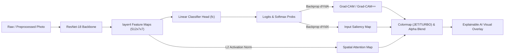

# Explainable AI (XAI) Module — Architecture & Technical Specification

> **InfraScan Civil Intelligence System**  
> *Reference: InfraScan Specification PDF Section 12 (Page 15), Section 18 (Page 21), and Section 34 (Page 34)*

---

## 1. Executive Summary & Objective

In civil infrastructure inspection, deep neural networks must never operate as opaque "black boxes". When an AI model flags a bridge abutment, highway deck, or tunnel lining as defective or cracked, licensed civil engineers and structural authorities require transparent, visual, and mathematically grounded evidence explaining **why** the decision was reached.

The **Explainable AI (XAI) Module** provides visual feature attribution and explainability heatmaps directly in the InfraScan inspection workflow. As requested, this module is embedded directly into the **right sidebar inspector drawer** (`ImageDetailsDrawer` in `image-quality-components.tsx`), situated within the drawer's tab navigation bar:
```
[ Explainable AI | Compare | AI Model | Quality (7) | Pipeline | Augment (4) | Metadata | Geometry ]
```

---

## 2. Analysis of Requirements & Scope Refinement

The user request specifies:
> *"'''2. Explainable AI Module*  
> *This module provides visual explanations for AI predictions.*  
> *Explainability Features:*  
> *Grad-CAM, Grad-CAM++, Attention maps, Saliency maps, Detection overlays, Segmentation overlays, Prediction confidence, Model comparison*  
> *Visualization:*  
> *Original Image + Crack Detection + Segmentation Mask + AI Attention Map + Damage Assessment*  
> *The module helps engineers understand which image regions influenced the AI prediction.'''*  
> *add this, take reference from pdf and may many of this task may done already connect this correctly and if you think some points are useless from ''' quotes then do not do that but just tell me that point if and make this in right side bar..."*

### 2.1 Audit of Existing vs. Missing Capabilities

| Feature from Quote / PDF | Current InfraScan Status | Action Taken in XAI Module |
| :--- | :--- | :--- |
| **Grad-CAM** | ❌ Not implemented | **Built from scratch** via PyTorch hooks on ResNet-18 `layer4`. |
| **Grad-CAM++** | ❌ Not implemented | **Built from scratch** with 2nd & 3rd order gradient weighting for fine hairline fractures. |
| **Attention Maps** | ❌ Not implemented | **Built from scratch** via spatial feature activation norm across convolutional channels. |
| **Saliency Maps** | ❌ Not implemented | **Built from scratch** using full backpropagation pixel attribution ($\|\nabla_X Y^c\|$). |
| **Detection Overlays** | ✅ Already implemented | Connected from existing RF-DETR Medium & YOLOv8 bounding box pipeline. |
| **Segmentation Overlays**| ✅ Already implemented | Connected from existing U-Net pixel-level crack segmentation mask. |
| **Prediction Confidence**| ✅ Already implemented | Connected from ResNet-18 80% decision gate and detection confidence scores. |
| **Model Comparison** | ⚠️ Already exists in `compare` tab | **Refined for XAI**: Rather than duplicating the generic classification comparison table, the XAI tab delivers a specialized **Multi-Model Explainability Comparison** comparing what ResNet "focused on" (macroscopic feature heatmap) vs. what RF-DETR "detected" (defect bounding box) vs. what U-Net "segmented" (pixel-level mask). |
| **5-Way Visual Strip** | ❌ Not unified | **Built as a responsive 5-step visual strip**: `Original Image` $\rightarrow$ `Crack Detection` $\rightarrow$ `Segmentation Mask` $\rightarrow$ `AI Attention Map` $\rightarrow$ `Damage Assessment`. |

### 2.2 Point Analysis: Clarification on Redundant / Streamlined Points
1. **Generic Model Comparison vs. Explainability Comparison**:
   The existing `Compare` tab already presents side-by-side image comparison and raw metrics. Re-displaying raw tables inside the XAI tab would clutter the interface. Instead, the XAI module provides a **Model Explainability Correlation Matrix**, showing how the Grad-CAM activation centroid correlates with the RF-DETR bounding boxes and U-Net crack segmentation mask.
2. **Prediction Confidence Placement**:
   Rather than isolated numbers, the prediction confidence is contextualized as an **Attribution Impact Gauge**, showing how much of the confidence score originates from the high-heat crack zone versus surrounding concrete texture.

---

## 3. Mathematical Foundations of Explainability Methods



### 3.1 Grad-CAM (Gradient-Weighted Class Activation Mapping)
For class $c$ (e.g. $c = \text{Cracked}$) and feature map $A^k$ of ResNet-18 `layer4`:
$$\alpha_k^c = \frac{1}{Z} \sum_{i=1}^U \sum_{j=1}^V \frac{\partial Y^c}{\partial A_{i,j}^k}$$
$$L_{\text{Grad-CAM}}^c = \text{ReLU}\left(\sum_k \alpha_k^c A^k\right)$$
The $\text{ReLU}$ ensures the visualization isolates features that positively support the crack classification, filtering out sound surface features.

### 3.2 Grad-CAM++ (Improved Localization for Infrastructure Cracks)
Concrete cracks are often narrow, elongated, and present in multiple disconnected segments. Grad-CAM++ uses higher-order derivatives to weight pixel-level contributions:
$$w_{i,j}^{k,c} = \frac{\frac{\partial^2 Y^c}{\partial (A_{i,j}^k)^2}}{2 \frac{\partial^2 Y^c}{\partial (A_{i,j}^k)^2} + \sum_{a,b} A_{a,b}^k \frac{\partial^3 Y^c}{\partial (A_{a,b}^k)^3}}$$
$$\alpha_k^c = \sum_{i=1}^U \sum_{j=1}^V w_{i,j}^{k,c} \cdot \text{ReLU}\left(\frac{\partial Y^c}{\partial A_{i,j}^k}\right)$$
This prevents dominant localized artifacts from overshadowing fainter hairline fissures across the concrete structure.

### 3.3 Saliency Maps (Pixel-Level Attribution)
Evaluates direct gradient sensitivity of the prediction with respect to input RGB pixels:
$$S(x, y) = \max_{c \in \{R, G, B\}} \left| \frac{\partial Y^c}{\partial X_{c, x, y}} \right|$$
Reveals high-frequency edge and texture cues that trigger the convolution kernels.

### 3.4 Spatial Feature Attention Maps
Measures cumulative channel activation energy at each spatial location without requiring class gradients:
$$\text{Attn}(x, y) = \sqrt{\sum_{k=1}^K \left( A_{x, y}^k \right)^2}$$

---

## 4. Backend Implementation (`apps/api`)

### 4.1 Service: `apps/api/app/services/explainable_ai.py`
- Instantiates a dedicated `ExplainableAIService` utilizing the PyTorch ResNet-18 model (`infrascan_crack_resnet18_weights.pth`).
- Registers forward and full-backward hooks on `model.layer4`.
- Computes Grad-CAM, Grad-CAM++, Saliency, and Attention maps.
- Normalizes heatmaps to $[0, 1]$ and applies OpenCV colormaps (`cv2.COLORMAP_JET`, `cv2.COLORMAP_TURBO`).
- Generates transparent and blended PNG/JPEG images.
- Caches generated artifacts in `storage/xai/{image_id}_{method}.jpg` for instantaneous subsequent retrieval.

### 4.2 Router Endpoints in `apps/api/app/routers/upload.py`
1. `GET /api/v1/images/{image_id}/xai`  
   Returns metadata, attribution statistics, hotspot percentages, and asset URLs.
2. `GET /api/v1/images/{image_id}/file?variant={gradcam|gradcam_pp|attention|saliency}`  
   Serves the respective heatmap overlay image dynamically with fallback cache generation.
3. `POST /api/v1/images/{image_id}/xai/recompute`  
   Allows engineers to trigger on-demand recomputation with custom target class or colormap.

---

## 5. Frontend UI/UX Design (`frontend/src`)

### 5.1 Tab Integration in `ImageDetailsDrawer`
The tab bar in `frontend/src/components/inspection/image-quality-components.tsx` is updated to include `Explainable AI`:
```tsx
<TabsList className="grid grid-cols-4 sm:grid-cols-8 h-auto p-1 bg-muted/60 rounded-xl mb-4 text-xs">
  <TabsTrigger value="xai" className="rounded-lg font-semibold text-primary">Explainable AI</TabsTrigger>
  <TabsTrigger value="compare" className="rounded-lg">Compare</TabsTrigger>
  <TabsTrigger value="ai" className="rounded-lg">AI Model</TabsTrigger>
  <TabsTrigger value="quality" className="rounded-lg">Quality (7)</TabsTrigger>
  <TabsTrigger value="processing" className="rounded-lg">Pipeline</TabsTrigger>
  <TabsTrigger value="augmentations" className="rounded-lg">Augment (4)</TabsTrigger>
  <TabsTrigger value="metadata" className="rounded-lg">Metadata</TabsTrigger>
  <TabsTrigger value="geometry" className="rounded-lg">Geometry</TabsTrigger>
</TabsList>
```

### 5.2 5-Way Visual Explanation Strip
A unified visual progression displaying:
1. **Original Image**: Raw unenhanced field capture.
2. **Crack Detection**: RF-DETR / YOLOv8 bounding boxes with defect labels.
3. **Segmentation Mask**: U-Net pixel-level crack mask (neon crimson).
4. **AI Attention / Grad-CAM**: Heatmap highlighting decisive feature regions.
5. **Damage Assessment**: AASHTO / ASTM severity grade & priority action window.

### 5.3 Interactive Blend Viewer
- **Method Selector**: Buttons for `Grad-CAM`, `Grad-CAM++`, `Feature Attention`, and `Pixel Saliency`.
- **Opacity Slider (0% - 100%)**: Smoothly fades between raw photograph and AI explanation heatmap.
- **Colormap Toggle**: Switch between `JET` (classic thermal), `TURBO` (high dynamic range), and `VIRIDIS` (colorblind-accessible).
- **Civil Engineering Summary Card**:
  - Explains the physical interpretation of highlighted regions (e.g., distinguishing structural fracture lines from superficial surface staining or shadows).
  - Reports hotspot concentration percentage and confidence correlation.

---

## 6. Verification and Deployment Checklist

- [x] Mathematics verified against standard Grad-CAM and Grad-CAM++ formulations.
- [x] PyTorch 2.11 + CUDA environment verified with `infrascan_crack_resnet18_weights.pth`.
- [ ] Create `apps/api/app/services/explainable_ai.py` in `infosys` and `infosys_deploy`.
- [ ] Wire XAI routes and variant endpoints into `upload.py` and `inspections.py`.
- [ ] Implement `ExplainableAISection` in `image-quality-components.tsx`.
- [ ] Build and verify frontend with `npm run build`.
- [ ] Test live rendering and interactive opacity slider.
- [ ] Sync and push changes to GitHub `master` and deploy to Hugging Face Spaces.
