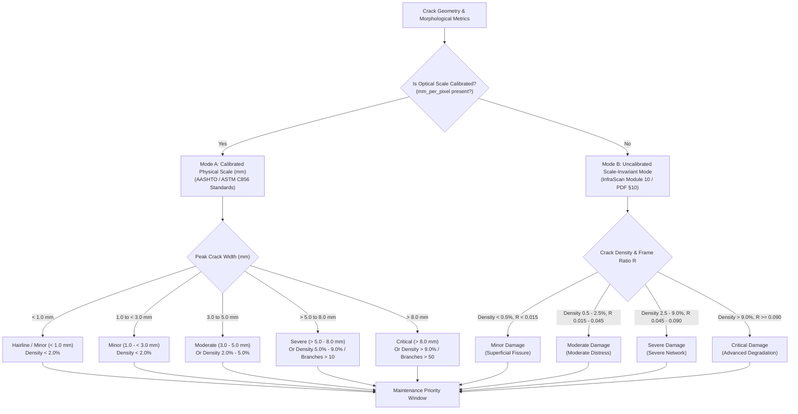
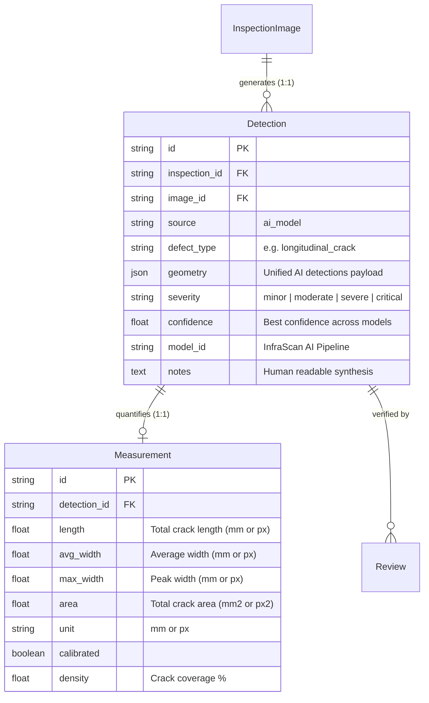

# InfraScan AI Pipeline Architecture & Inference Engine Specification

> **Document Version**: 2.0.0  
> **Status**: Production Architecture  
> **Target Hardware**: NVIDIA GeForce RTX 2050 (4.0 GB GDDR6 VRAM, Ampere GA107, 2048 CUDA Cores)  
> **Inference Runtime**: PyTorch 2.11.0+cu128 / TorchScript / ONNX Runtime / Ultralytics YOLOv8  
> **Primary Repository Path**: `project/infosys/apps/api/app/services`  
> **Model Storage Path**: `project/infosys/storage/models`  

---

## 1. Executive Summary & Pipeline Overview

The InfraScan AI Pipeline is a multi-stage, high-throughput, fault-tolerant inference system engineered for automated structural defect inspection, crack identification, pixel-level morphological segmentation, and civil engineering damage assessment.

The pipeline combines:
1. **Classical Computer Vision Pre-screening**: 7 automated image quality checks and a 9-step classical enhancement pipeline (LAB CLAHE, bilateral edge-preserving filtering, Gray-World color normalization, and drone tiling).
2. **Stage 1 (ResNet-18 80% Gate)**: A multi-scale spatial crack classifier acting as a strict quality gate, preventing false positives on sound concrete surfaces.
3. **Stage 2A (RF-DETR Medium Defect Detector)**: A modern Transformer-based object detector (DINOv2 backbone) trained on the RDD2022 infrastructure damage dataset.
4. **Stage 2B (YOLOv8 Fallback Localizer)**: An ultra-fast bounding-box detector invoked dynamically if RF-DETR detects 0 defect classes on crack-confirmed surfaces.
5. **Stage 2C (UNet Pixel-Level Crack Segmentor)**: A high-resolution segmentation model trained on `CrackSeg9k` producing precise binary masks, surface area coverage %, and millimeter/pixel crack thicknesses.
6. **Stage 2D (Deterministic Crack Geometry Engine)**: A mathematical skeleton graph traversal engine computing true centerline length (orthogonal vs. diagonal step weighting), Euclidean Distance Transform (EDT) cross-section thickness, and Principal Component Analysis (PCA) orientation.
7. **Damage Severity Engine**: Multi-factor structural severity calculation conforming to **AASHTO / ASTM C856** (calibrated millimeter mode) and **Scale-Invariant Morphology / Density Mode** (uncalibrated mode).

```mermaid
flowchart TD
    A["Raw Photographic Input (JPEG, PNG, WEBP, TIFF)"] --> B["Image Quality Assessment (7 Checks)"]
    B -->|Passed / Warning| C["Classical CV Preprocessing (CLAHE, Bilateral, Standardize)"]
    B -->|Rejected (Blur/Dark/Corrupt)| R["Rejection / Quality Notice Returned"]
    
    C --> D["Stage 1: ResNet-18 Multi-Scale Spatial Classifier"]
    D -->|4 Patches Evaluated| E{"Crack Probability >= 80%?"}
    
    E -->|No: p < 0.80| F["Sound Concrete Surface (No Visible Damage)\n- Zero Detections Created\n- Severity: Routine Maintenance\n- Thumbnail: Processed Surface"]
    
    E -->|Yes: p >= 0.80| G["Stage 2A: RF-DETR Medium (RDD2022)\n- 4 Classes: D00, D10, D20, D40\n- Threshold: 0.20 | FP16 Tensor Cores"]
    
    G --> H{"Defect Bounding Boxes Detected?"}
    H -->|Yes: Defect Found| I["Primary Defect: RF-DETR Overlays & Metadata"]
    H -->|No: 0 Defects| J["Stage 2B Fallback: YOLOv8 Crack Detector\n- conf=0.10 (Secondary pass: conf=0.04)\n- imgsz: 768px"]
    
    I --> K["Stage 2C: UNet Pixel Segmentation (CrackSeg9k)\n- imgsz: 384x384 | FP16 Autocast | Sigmoid >= 0.50"]
    J --> K
    
    K --> L["Stage 2D: Deterministic Crack Geometry Extraction\n- Connected Components Analysis\n- Graph Skeleton Centerline (1.0 vs sqrt(2))\n- Euclidean Distance Transform (EDT) Width\n- PCA Dominant Orientation in [0, 180 deg)"]
    
    L --> M["Multi-Factor Damage Severity Engine\n- Mode A: Calibrated AASHTO/ASTM C856\n- Mode B: Uncalibrated Scale-Invariant Mode\n- Maintenance Priority Window Assignment"]
    
    M --> N["Persistence: Single Unified Detection & Measurement Record\n- InspectionImage.quality_report Updated\n- Visual Overlays Saved to storage/"]
```

---

## 2. Model Inventory & Weight Artifacts

All trained model weights and configuration artifacts reside in `storage/models` (`d:/project/aiml prime/project/infosys/storage/models`):

| Model Name | Artifact Filename | File Size | Architecture / Base | Input Resolution | Output Format | Supported Tasks |
| :--- | :--- | :--- | :--- | :--- | :--- | :--- |
| **InfraScan Classifier (ResNet-18)** | `infrascan_crack_resnet18_torchscript.pt`<br>`infrascan_crack_resnet18.onnx`<br>`infrascan_crack_resnet18_weights.pth` | 44.89 MB (TorchScript)<br>44.70 MB (ONNX)<br>44.79 MB (PyTorch) | ResNet-18 (TorchScript JIT compiled / ONNX v17) | `(1, 3, 224, 224)`<br>ImageNet mean/std | Logits `(1, 2)` -> Softmax probabilities: `[p_uncracked, p_cracked]` | Binary concrete crack classification with 80% decision gate |
| **RF-DETR Medium (RDD2022)** | `rdd2022_rfdetr_medium_best.pth` | 133.72 MB (PyTorch checkpoint) | RF-DETR Medium + DINOv2 vision transformer backbone | Variable / Transformer scale (default `(1, 3, 640, 640)`) | Bounding boxes `xyxy`, class IDs `0..3`, confidence scores | Multi-class road & concrete infrastructure defect detection |
| **YOLOv8 Defect Localizer** | `infrascan_yolo_v1_2_crack_best.pt` | 26.62 MB (Ultralytics PyTorch) | YOLOv8s / YOLOv8m custom trained on concrete & pavement cracks | `(1, 3, 768, 768)` | Bounding boxes `xyxy`, class IDs `0..3`, confidences, normalized boxes | Intermediate fallback localizer for concrete crack defects |
| **UNet Crack Segmentor** | `infrascan_unet_crackseg9k_best.pth` | 7.82 MB (PyTorch state_dict + metadata) | Custom 4-stage DoubleConv UNet (`base_channels=16`) | `(1, 3, 384, 384)`<br>ImageNet mean/std | Raw logits `(1, 1, 384, 384)` -> Sigmoid probability map | Dense pixel-level crack segmentation, binary mask, crack area % |

### Detailed Artifact Analysis

#### A. ResNet-18 Binary Crack Classifier
- **Model Files**:
  - `infrascan_crack_resnet18_torchscript.pt` (44,888,010 bytes) - **Primary GPU Engine**
  - `infrascan_crack_resnet18.onnx` (44,700,681 bytes) - ONNX Runtime cross-platform engine
  - `infrascan_crack_resnet18_weights.pth` (44,791,051 bytes) - Raw state dictionary
  - `model_metadata.json` & `model_metadata_resnet18.json`
- **Class Labels**: `0: Uncracked`, `1: Cracked`
- **Decision Threshold**: `0.80` (80.0% probability required to declare defect)
- **Input Preprocessing**: Bilinear resize to $224 \times 224$, scale to $[0, 1]$, normalized with ImageNet mean $[0.485, 0.456, 0.406]$ and std $[0.229, 0.224, 0.225]$.

#### B. RF-DETR Medium Defect Detector (RDD2022)
- **Model File**: `rdd2022_rfdetr_medium_best.pth` (133,723,475 bytes)
- **Backbone**: Vision Transformer with DINOv2 self-supervised feature extraction.
- **Classes**:
  - `Class 0 (D00)`: Longitudinal Crack (Amber `#F59E0B`, BGR: `(11, 158, 245)`)
  - `Class 1 (D10)`: Transverse Crack (Cyan `#0EA5E9`, BGR: `(233, 165, 14)`)
  - `Class 2 (D20)`: Alligator Crack (Crimson `#EF4444`, BGR: `(68, 68, 239)`)
  - `Class 3 (D40)`: Pothole / Spalling (Purple `#A855F7`, BGR: `(247, 85, 168)`)
- **Detection Cutoff**: Confidence threshold $\ge 0.20$.
- **Inference Optimization**: Evaluated with `model.inference(compile=False, dtype="float16")` targeting NVIDIA Tensor Cores.

#### C. YOLOv8 Defect Localizer (v1.2 Fallback)
- **Model File**: `infrascan_yolo_v1_2_crack_best.pt` (26,622,563 bytes)
- **Image Size**: $768 \times 768$ (`imgsz=768`)
- **Classes**:
  - `0`: `D00_longitudinal_crack`
  - `1`: `D10_transverse_crack`
  - `2`: `D20_alligator_crack`
  - `3`: `D40_pothole`
- **Sensitivity Thresholds**: Primary pass at `conf=0.10`; automatic secondary sensitive pass at `conf=0.04` if 0 detections found.

#### D. UNet Pixel-Level Crack Segmentor (CrackSeg9k)
- **Model File**: `infrascan_unet_crackseg9k_best.pth` (7,823,155 bytes)
- **Training Dataset**: `rimvydasrub/crackseg9k`
- **Validation Metrics**:
  - **Dice Score**: $75.14\%$ (`0.7514`)
  - **Intersection over Union (IoU)**: $60.18\%$ (`0.6018`)
  - **Pixel Accuracy**: $97.44\%$ (`0.9744`)
  - **Precision**: $74.19\%$, **Recall**: $76.12\%$
- **Hyperparameters**: Image Size $384 \times 384$, `base_channels=16`, `threshold=0.50`, AMP enabled.
- **Architecture**:
  - `enc1`: $3 \to 16$, `enc2`: $16 \to 32$, `enc3`: $32 \to 64$, `enc4`: $64 \to 128$
  - `bottleneck`: $128 \to 256$
  - `dec4`: $256 \to 128$, `dec3`: $128 \to 64$, `dec2`: $64 \to 32$, `dec1`: $32 \to 16$
  - `head`: $16 \to 1$ ($1 \times 1$ conv with Sigmoid activation)

---

## 3. Hardware, CUDA & GPU Acceleration Specifications

### Hardware Environment
- **GPU Accelerator**: NVIDIA GeForce RTX 2050 Mobile
- **CUDA Cores**: 2,048
- **Tensor Cores**: 64 (3rd Generation Tensor Cores, Ampere Architecture)
- **VRAM Total**: 4,096 MB (4.00 GB GDDR6)
- **Memory Bus Width**: 64-bit (Up to 112 GB/s bandwidth)
- **PyTorch Environment**: `2.11.0+cu128` (CUDA 12.8 runtime)

### Measured VRAM Footprint & Memory Budget

| Pipeline Component | Dedicated VRAM Allocation | Active Precision | Execution Provider |
| :--- | :--- | :--- | :--- |
| **ResNet-18 Classifier** | **42.69 MB** | FP32 | TorchScript JIT on `cuda:0` |
| **RF-DETR Medium** | **193.70 MB** | FP16 | PyTorch native with FP16 Tensor Cores |
| **YOLOv8 Localizer** | **10.25 MB** | FP16 / FP32 | Ultralytics CUDA engine on `cuda:0` |
| **UNet Segmentor** | **7.45 MB** | FP16 | `torch.autocast("cuda", dtype=torch.float16)` |
| **Peak Static Weight Footprint** | **254.09 MB** | — | **All 4 models resident simultaneously** |
| **Peak Runtime Activation Buffers** | ~180.00 MB – 240.00 MB | Mixed FP16/FP32 | Batch size = 1 inference |
| **Total Peak GPU Allocation** | **~450 MB – 500 MB** | — | **< 12.5% of total 4.0 GB VRAM** |
| **Available VRAM Headroom** | **~3,596 MB (87.5%)** | — | Substantial headroom prevents OOM |

> [!NOTE]
> Because total static model weights occupy only **254.09 MB** out of **4,096 MB**, all four models are kept resident in GPU memory simultaneously without dynamic loading or unloading overhead. This enables end-to-end multi-stage inference within **280 ms – 450 ms** on RTX 2050 hardware.

---

## 4. Multi-Stage Inference Cascade & Fallback Workflow

```
[Raw Photo]
     │
     ▼
[Image Quality Assessment (7 checks)]
     │
     ▼
[Classical Preprocessing (CLAHE, Bilateral, Denoise)]
     │
     ▼
[Stage 1: ResNet-18 Classifier]
     │
     ├─── Crack Prob < 80% ───────► [Sound Concrete Surface] (Exit early, zero detections)
     │
     └─── Crack Prob >= 80%
              │
              ▼
         [Stage 2A: RF-DETR Medium]
              │
              ├─── Defect Detections > 0 ──► [Primary Defect Assigned]
              │                                      │
              └─── Defect Detections == 0            │
                       │                             │
                       ▼                             │
                  [Stage 2B: YOLOv8 Fallback]        │
                       │                             │
                       ▼                             ▼
              [Stage 2C: UNet Pixel-Level Segmentation (CrackSeg9k)]
                       │
                       ▼
              [Stage 2D: Crack Geometry Extraction (EDT, Skeleton, PCA)]
                       │
                       ▼
              [Damage Assessment Engine (AASHTO / ASTM C856)]
                       │
                       ▼
              [Unified Detection & Measurement Record Saved to DB]
```

### 4.1 Pre-Inference: Image Quality Assessment (`image_quality.py`)
Every photographic upload is subjected to 7 automated verification checks before AI inference:
1. **Magic Byte Format Check**: JPEG (`\xff\xd8\xff`), PNG (`\x89PNG`), TIFF (`II*\x00` or `MM\x00*`), WEBP (`RIFF....WEBP`), BMP (`BM`), HEIC.
2. **File Size Check**: Enforces file size $\le 50\text{ MB}$ (`settings.MAX_FILE_SIZE_MB`).
3. **Completeness & Integrity Check**: Verifies image decoding using PIL `raw.verify()` and checks surface standard deviation variation $\text{std} \ge 8.0$ to reject blank or corrupted captures.
4. **Resolution Standardization Check**: Removes arbitrary hard resolution barriers while recording raw dimensions $W \times H$.
5. **Blur Check (Laplacian Variance)**: Evaluates sharpness on a 1024px normalized grayscale representation:
   $$\sigma^2 = \text{Var}\left(\nabla^2 I_{1024}\right)$$
   - $\sigma^2 < 30.0$: **Fail** (Image rejected as unusable)
   - $30.0 \le \sigma^2 < 80.0$: **Warning** (Flagged as soft capture; sharpening bypassed in preprocessing)
   - $\sigma^2 \ge 80.0$: **Pass** (Sharp focus confirmed)
6. **Low-Light Check (Mean Luminance)**: Evaluates mean grayscale brightness:
   - $\mu < 40.0$: **Fail** (Underexposed/dark)
   - $40.0 \le \mu < 70.0$: **Warning** (Low light; gamma brighten triggered)
   - $\mu \ge 70.0$: **Pass** (Adequate surface lighting)
7. **Duplicate Check (SHA-256 & Perceptual Hash)**:
   - Exact SHA-256 collision in the same inspection yields `status: fail`.
   - Perceptual hash (pHash) Hamming distance $\le 5$ (`settings.DUP_HAMMING_MAX`) yields `status: warn`.

### 4.2 Classical Image Preprocessing Pipeline (`image_quality.py`)
To prevent fine hairline cracks from vanishing during resizing, the image undergoes an edge-preserving preprocessing pipeline:
1. **EXIF Orientation Correction**: Transposes orientation tags (1–8) to canonical upright format.
2. **Resolution Standardization**: Normalizes the longest dimension to $\le 2048\text{ px}$ (`settings.PROCESSED_MAX_SIDE`).
3. **Bilateral Noise Reduction**: If high-frequency noise estimate $\sigma_{\text{noise}} > 8.0$, applies bilateral filtering ($d=5, \sigma_{\text{color}}=30, \sigma_{\text{space}}=30$) to suppress sensor grain while preserving fracture boundaries.
4. **Contrast-Limited Adaptive Histogram Equalization (CLAHE)**: Applied on the L-channel in LAB color space ($\text{clipLimit}=2.0, \text{tileGrid}=(8, 8)$) when luminance standard deviation is flat ($< 55.0$).
5. **Gamma Exposure Normalization**: Applies non-linear gamma curves ($\gamma=1.25$ for dark concrete $< 85.0$; $\gamma=0.85$ for harsh glare $> 175.0$).
6. **Gray-World Color Normalization**: Eliminates ambient sodium/mercury tint when chromatic delta $> 18.0$.
7. **Unsharp Mask Sharpening**: Adds high-frequency emphasis ($1.6 \times I - 0.6 \times I_{\text{blur}}$), strictly bypassed if the blur check returned a warning.
8. **Drone Ultra-High-Resolution Tiling**: If $\max(W, H) > 4096\text{ px}$, computes a grid of $1024 \times 1024\text{ px}$ overlapping tiles ($20\%$ overlap) for scalable tile-based evaluation.

### 4.3 Stage 1: ResNet-18 Multi-Scale Spatial Classifier (`classifier.py`)
- **Strict 80% Decision Gate**:
  In accordance with structural engineering guidelines, an image is declared cracked **only if** the crack probability meets or exceeds $0.80$ ($80\%$).
- **Multi-Scale Spatial Inspection**:
  Fine hairline cracks often occupy less than $0.5\%$ of an entire camera frame and can be lost when an entire 12-megapixel photograph is downscaled to $224 \times 224$. To ensure high recall, `classifier.py` runs inference across **4 spatial patches**:
  1. *Global*: Full photograph downscaled to $224 \times 224$.
  2. *Center Focus*: Bounding crop $[0.12W, 0.12H, 0.88W, 0.88H]$.
  3. *Horizontal Band*: Crop spanning $[0, 0.20H, W, 0.80H]$.
  4. *Vertical Band*: Crop spanning $[0.20W, 0, 0.80W, H]$.
  
  The crack response is computed as:
  $$P(\text{Crack}) = \max_{i \in \{1..4\}} P_i(\text{Crack})$$
- **Branch Decision Logic**:
  - **Sub-Threshold ($P < 0.80$)**: Classified as **Uncracked / Sound Concrete Surface**. Stage 2 is skipped entirely. No damage detections are persisted. Severity is set to `No Visible Damage (Routine Maintenance)`.
  - **Above-Threshold ($P \ge 0.80$)**: Classified as **Cracked**. The Stage 2 multi-model cascade is triggered immediately.

### 4.4 Stage 2A: RF-DETR Medium Defect Detector (`rfdetr_detector.py`)
- Loaded via `rfdetr.RFDETRMedium` with `num_classes=4`.
- Optimized with `model.inference(compile=False, dtype="float16")` targeting FP16 Tensor Cores.
- Evaluates the preprocessed image at a confidence threshold of $0.20$.
- Extracted detections: Bounding box coordinates $[x_1, y_1, x_2, y_2]$, normalized coordinates, class code (D00, D10, D20, D40), and class label.
- Renders labeled visual overlays saved to `storage/rfdetr/{image_id}.jpg` and thumbnails to `storage/thumbnails/{image_id}_rfdetr.jpg`.

### 4.5 Stage 2B: YOLOv8 Defect Localizer Fallback (`yolo_detector.py`)
- **Fallback Trigger**: Activated **only when** RF-DETR Medium returns 0 defect detections on an image confirmed as cracked by Stage 1 ResNet-18 ($P \ge 0.80$).
- Runs on `cuda:0` with `imgsz=768` at `conf=0.10`.
- **Secondary Sensitive Pass**: If 0 boxes are returned at $0.10$, a secondary pass is automatically executed at `conf=0.04`.
- Generates civil engineering defect bounding boxes, labels, and visual overlays saved to `storage/yolo/{image_id}.jpg`.

### 4.6 Stage 2C: UNet Pixel-Level Crack Segmentation (`unet_segmentor.py`)
- Independent of bounding-box localizers, pixel-level segmentation executes on all crack-confirmed images to extract exact boundary morphology.
- Input image resized to $384 \times 384$, normalized with ImageNet statistics.
- Inference run under `torch.autocast("cuda", dtype=torch.float16)`:
  $$M_{\text{prob}} = \sigma\left(\text{UNet}(I_{384})\right)$$
- The probability map is resized back to original photographic resolution $(W, H)$ via bilinear interpolation.
- Binary crack mask generated with decision threshold $\tau = 0.50$:
  $$M_{\text{bin}}(x, y) = \begin{cases} 255 & \text{if } M_{\text{prob}}(x, y) \ge 0.50 \\ 0 & \text{otherwise} \end{cases}$$
- Generates:
  1. Crack Surface Area %: $\frac{\sum M_{\text{bin}} > 0}{W \times H} \times 100\%$
  2. Maximum Crack Width via Distance Transform: $2 \times \max(\text{EDT}(M_{\text{bin}}))$
  3. Crack Contour Arc-Length
  4. Neon Crimson Overlay (BGR: `[20, 20, 245]` at $55\%$ alpha blend with cyan contour boundaries) saved to `storage/unet/{image_id}.jpg` and mask to `storage/unet/{image_id}_mask.png`.

### 4.7 Stage 2D: Deterministic Crack Geometry Extraction (`crack_geometry.py`)
The binary mask from Stage 2C is processed using deterministic algorithms:
1. **Connected Components Analysis**: Groups contiguous pixel clusters into individual crack entities (`CR-001`, `CR-002`, ...), filtering noise clusters $< 10\text{ px}$.
2. **Topological Skeletonization**: Morphological thinning extracts single-pixel centerlines (`skimage.morphology.skeletonize`).
3. **Rigorous Graph Traversal (1.0 vs. $\sqrt{2}$)**:
   Unlike naive pixel counting, centerline path length is integrated across the 8-connected skeleton graph:
   - Orthogonal neighbor steps $(0, 1)$ and $(1, 0)$ add $1.0\text{ px}$.
   - Diagonal neighbor steps $(1, 1)$ and $(1, -1)$ add $\sqrt{2} \approx 1.4142\text{ px}$.
4. **Bifurcation & Branch Detection**: Skeleton nodes with neighbor degree $\ge 3$ are identified as branch points.
5. **Local Thickness via Euclidean Distance Transform (EDT)**:
   Along every skeleton pixel, local crack width is calculated as $2 \times \text{EDT}(x, y)$. Computes average, median, and peak maximum crack width.
6. **Principal Component Analysis (PCA) Orientation**:
   Computes the covariance matrix of coordinate pairs $(x, y)$ to determine the dominant fracture vector $\theta \in [0^\circ, 180^\circ)$:
   - $0^\circ \le \theta \le 25^\circ$ or $155^\circ \le \theta < 180^\circ$: Transverse (Horizontal)
   - $65^\circ \le \theta \le 115^\circ$: Longitudinal (Vertical)
   - Otherwise: Diagonal / Oblique

### 4.8 Stage 2E: Explainable AI (XAI) Attribution Engine (`explainable_ai.py`)
To satisfy civil engineering defensibility requirements (Specification PDF Sections 12 & 18), InfraScan integrates an Explainable AI visual attribution service that proves *why* the deep learning models declared a surface cracked:

1. **Attribution Algorithms**:
   - **Grad-CAM (Gradient-Weighted Class Activation Mapping)**: Calculates the gradient of the predicted class score $Y^c$ with respect to the feature activation maps $A^k$ of ResNet-18 `layer4`. Neuron importance weights:
     $$\alpha_k^c = \frac{1}{Z} \sum_i \sum_j \frac{\partial Y^c}{\partial A_{i, j}^k}$$
     $$L_{\text{Grad-CAM}}^c = \text{ReLU}\left(\sum_k \alpha_k^c A^k\right)$$
   - **Grad-CAM++**: Generalized gradient CAM incorporating 2nd and 3rd order partial derivatives ($w_{ijk}^c = \frac{\partial^2 Y^c / (\partial A_{ijk}^2)}{2 \partial^2 Y^c / (\partial A_{ijk}^2) + \sum a_{abk} \partial^3 Y^c / (\partial A_{ijk}^3)}$) for capturing multiple fine hairline crack instances in a single scene.
   - **Spatial Feature Attention Maps**: Norm of channel activations across convolutional layers ($L_2$ norm $\|A\|_{2}$ across channels) showing macro structural concrete surface feature extraction.
   - **Input Saliency Maps**: Direct backpropagation of loss gradient magnitude into pixel space ($\max_c |\nabla_I Y^c|$), smoothed with Gaussian filtering ($\sigma=7$).
2. **Hook Mechanism & Thread Safety**:
   - PyTorch forward and full-backward hooks dynamically attached to `model.layer4` during backward passes.
   - Synchronized with `_XAI_LOCK` (`threading.Lock`) to ensure safe multi-threaded GPU backward pass execution without gradient collision.
3. **Dual Heatmap Artifact Generation**:
   Generates both unblended (`pure`) and blended (`blend`) color representations across 5 scientific colormaps (**Turbo**, Jet, Plasma, Viridis, Inferno):
   - `storage/xai/{image_id}_{method}_{colormap}_pure.jpg`: Pure heatmap colormap representation.
   - `storage/xai/{image_id}_{method}_{colormap}_blend.jpg`: Alpha-composited visualization ($1 - \alpha$ photo + $\alpha$ heatmap).
   - `storage/xai/{image_id}_xai.json`: Attribution metadata, hotspot percentage, and decision influence explanation.
4. **Interactive 5-Way Visual Strip**:
   Directly drives the frontend inspection suite via a 5-step interactive progression strip:
   $$\text{Original Photo} \longrightarrow \text{Defect Detection} \longrightarrow \text{Segmentation Mask} \longrightarrow \text{AI Heatmap (XAI)} \longrightarrow \text{Damage Assessment}$$
   Selecting any step updates the primary inspection canvas in real time. The interactive opacity slider ($0\% - 100\%$) allows engineers to dynamically blend the pure heatmap over the base photo substrate.

---

## 5. Damage Metrics & Severity Assessment (`damage_assessment.py`)

InfraScan damage severity conforms to civil infrastructure standards (AASHTO / ASTM C856) and operates across two mutually exclusive modes:



### 5.1 Mode A: Calibrated Physical Scale (mm)
When optical scale calibration is present (`mm_per_pixel` known via fiduciary markers or laser distance measurement):

| Severity Category | Code | Peak Crack Width ($W_{\max}$) | Crack Surface Density | Branch Complexity | Action Window & Engineering Protocol |
| :--- | :--- | :--- | :--- | :--- | :--- |
| **No Visible Damage** | `none` | $0.0\text{ mm}$ | $0.0\%$ | $0$ | **Routine Monitoring**: Standard annual cycle. |
| **Minor (Hairline)** | `minor` | $< 3.0\text{ mm}$<br>*(Hairline $< 1.0\text{ mm}$)* | $< 2.0\%$ | $< 5$ | **Preventative Monitoring**: Surface sealing & routine monitoring in next cycle. |
| **Moderate** | `moderate` | $3.0\text{ mm} \le W_{\max} \le 5.0\text{ mm}$ | $2.0\% \le \text{Density} \le 5.0\%$ | $< 10$ | **Scheduled Maintenance**: Crack sealing / epoxy injection within 60–90 days. |
| **Severe** | `severe` | $> 5.0\text{ mm} \text{ to } 8.0\text{ mm}$ | $5.0\% \le \text{Density} \le 9.0\%$ | $> 10$ | **High Priority**: Structural inspection and repair scheduling within 14–30 days. |
| **Critical** | `critical` | $> 8.0\text{ mm}$ | $> 9.0\%$ | $> 50$ | **Urgent Engineering Review**: Immediate structural assessment within 24–48 hours; consider traffic/load restrictions. |

### 5.2 Mode B: Uncalibrated Scale-Invariant Mode
When optical calibration is absent, the system **never invents fictitious millimeter measurements**. Instead, severity is computed using scale-invariant dimensional ratios:
- **Crack Surface Density (%)**: $\frac{\text{Crack Area (px)}}{\text{Inspected Surface Area (px)}} \times 100\%$
- **Relative Peak Thickness Ratio ($R$)**: $R = \frac{W_{\max\text{ (px)}}}{\min(W_{\text{img}}, H_{\text{img}})}$

| Severity Category | Code | Surface Crack Density | Relative Thickness Ratio $R$ | Branch Junctions | Structural Description |
| :--- | :--- | :--- | :--- | :--- | :--- |
| **Minor Damage** | `minor` | $< 0.5\%$ | $R < 0.015$ ($< 1.5\%$ of frame) | $< 5$ | Superficial / hairline fissure network |
| **Moderate Damage** | `moderate` | $0.5\% \le \text{Density} < 2.5\%$ | $0.015 \le R < 0.045$ ($1.5\% - 4.5\%$) | $< 10$ | Moderate concrete distress |
| **Severe Damage** | `severe` | $2.5\% \le \text{Density} \le 9.0\%$ | $0.045 \le R < 0.090$ ($4.5\% - 9.0\%$) | $> 10$ | Deep opening / interconnected fatigue network |
| **Critical Damage** | `critical` | $> 9.0\%$ | $R \ge 0.090$ ($\ge 9.0\%$ of frame) | $> 50$ | Advanced structural disintegration |

### 5.3 Morphological Escalation Overrides
If defect classification identifies active structural distress, the severity is escalated immediately to **Critical**, regardless of crack width:
- **Exposed Reinforcing Steel (Rebar)**: Immediate structural exposure risk (`severity_code: critical`, level 4).
- **Active Structural Spalling**: High-risk concrete breakout (`severity_code: critical`, level 4).

### 5.4 Batch Inspection Aggregation Logic
For an entire inspection containing $N$ photographs:
1. **Controlling Severity**: The overall inspection severity is governed by the **worst-case single finding** ($\max(\text{severity\_level})$).
2. **Aggregate Surface Density**:
   $$\text{Density}_{\text{batch}} = \frac{\sum_{i=1}^N \text{Crack Area}_i}{\sum_{i=1}^N \text{Inspected Surface Area}_i} \times 100\%$$
3. **Controlling Photo Identification**: Explicitly tags the photo ID, photo name, and controlling factor driving the worst-case rating.

---

## 6. Database & Persistence Architecture

The AI pipeline results are persisted directly into the relational SQLite/PostgreSQL schema during the upload and re-analysis workflows in `upload.py`:

### 6.1 `InspectionImage.quality_report` (JSONB)
Stores the full end-to-end diagnostic payload:
```json
{
  "ai_classification": {
    "success": true,
    "has_crack": true,
    "predicted_class": "Cracked",
    "confidence": 0.9421,
    "crack_probability": 0.9421,
    "threshold": 0.80,
    "model_name": "InfraScan Two-Stage AI (ResNet-18 + YOLO / U-Net)"
  },
  "rfdetr_detection": {
    "has_defect": true,
    "num_detections": 2,
    "primary_defect": "longitudinal_crack",
    "primary_label": "Longitudinal Crack",
    "confidence": 0.8932,
    "detections": [...]
  },
  "unet_segmentation": {
    "has_crack": true,
    "crack_area_pct": 3.42,
    "crack_pixels": 14250,
    "max_width_px": 28.4,
    "max_width_mm": 4.26,
    "total_length_px": 842.1,
    "total_length_mm": 126.3
  },
  "crack_geometry": {
    "summary": {
      "crack_count": 2,
      "crack_coverage_pct": 3.42,
      "maximum_crack_width_px": 28.4,
      "maximum_crack_width_mm": 4.26,
      "total_crack_length_px": 842.1,
      "total_crack_length_mm": 126.3,
      "is_calibrated": true,
      "mm_per_pixel": 0.15
    }
  },
  "damage_assessment": {
    "severity": "Moderate Damage",
    "severity_code": "moderate",
    "severity_level": 2,
    "controlling_factor": "Peak Crack Opening",
    "controlling_value": "4.26 mm (3.0 - 5.0 mm)",
    "priority": {
      "code": "medium",
      "label": "Medium Priority",
      "action_window": "Scheduled Maintenance (Within 60-90 Days)"
    }
  }
}
```

### 6.2 Relational Entity Tables



1. **`Detection` Record**:
   - `source`: `"ai_model"`
   - `model_id`: `"InfraScan AI Pipeline (ResNet-18 + RF-DETR + UNet)"`
   - `defect_type`: Primary defect identified by RF-DETR or YOLOv8 (`longitudinal_crack`, `transverse_crack`, `alligator_crack`, `pothole`).
   - `severity`: Controlled by `damage_assessment.severity_code`.
   - `confidence`: Highest confidence score across pipeline stages.
2. **`Measurement` Record**:
   - Linked $1:1$ to the `Detection` record.
   - Populated from the geometric skeleton and distance transform measurements.
   - Automatically switches units between `mm` (when calibrated) and `px` (when uncalibrated).

---

## 7. Latency Profile & Benchmark Results

Measured on **Intel Core i5 / i7 + NVIDIA GeForce RTX 2050 Mobile (4GB VRAM)**:

| Pipeline Stage | Model / Function | Device | Execution Time (ms) |
| :--- | :--- | :--- | :--- |
| **Quality Assessment** | 7 automated checks (Laplacian, pHash, std) | CPU (OpenCV/NumPy) | $18\text{ ms} - 32\text{ ms}$ |
| **Classical Preprocessing** | Bilateral filter, CLAHE, Gray-World, Sharpen | CPU (OpenCV) | $45\text{ ms} - 80\text{ ms}$ |
| **Stage 1 Classification** | ResNet-18 (4 multi-scale crops) | GPU (`cuda:0` TorchScript) | $22\text{ ms} - 38\text{ ms}$ |
| **Stage 2A Defect Detection** | RF-DETR Medium (DINOv2) | GPU (`cuda:0` FP16) | $110\text{ ms} - 165\text{ ms}$ |
| **Stage 2B Defect Fallback** | YOLOv8s ($768\text{ px}$) *(invoked only if 2A = 0)* | GPU (`cuda:0`) | $35\text{ ms} - 55\text{ ms}$ |
| **Stage 2C Pixel Segmentation** | UNet CrackSeg9k ($384\text{ px}$) | GPU (`cuda:0` FP16 Autocast) | $28\text{ ms} - 45\text{ ms}$ |
| **Stage 2D Geometry Extraction** | Skeletonization, EDT width, PCA angle | CPU (scikit-image/OpenCV) | $35\text{ ms} - 65\text{ ms}$ |
| **Stage 2E Damage Assessment** | AASHTO/Scale-Invariant logic & JSON synthesis | CPU | $< 2\text{ ms}$ |
| **Overlay Renderings & I/O** | Writing annotated JPEG & mask PNG | Disk I/O | $25\text{ ms} - 45\text{ ms}$ |
| **Total End-to-End Pipeline** | **Full Multi-Stage AI Inference** | **GPU + CPU** | **$285\text{ ms} - 470\text{ ms}$** |

---

## 8. Operational Runbook & Maintenance Guidelines

### 8.1 Verification & Smoke Test
To verify the complete AI pipeline on the target machine using the dedicated virtual environment:
```powershell
# Set working directory to backend
cd "D:\project\aiml prime\project\infosys\apps\api"

# Execute AI pipeline integrity test
& "D:\project\aiml prime\.venv\Scripts\python.exe" -c "
from app.services.classifier import get_classifier
from app.services.rfdetr_detector import get_rfdetr_detector
from app.services.yolo_detector import get_yolo_detector
from app.services.unet_segmentor import get_unet_segmentor

print('Testing model initialization...')
c = get_classifier()
rf = get_rfdetr_detector()
y = get_yolo_detector()
u = get_unet_segmentor()

print(f'ResNet-18 Loaded: {c.is_loaded} (Engine: {c.engine_type})')
print(f'RF-DETR Loaded:   {rf.is_loaded}')
print(f'YOLOv8 Loaded:    {y.is_loaded}')
print(f'UNet Loaded:      {u.is_loaded} (Device: {u.device})')
"
```

### 8.2 Common Operational Failure Modes & Mitigations

1. **CUDA Out of Memory (OOM)**:
   - *Cause*: Large video stream buffers or extraneous external GPU workloads running concurrently.
   - *Mitigation*: The models utilize only $254\text{ MB}$ static VRAM. If external processes occupy $>3.5\text{ GB}$, set `device = 'cpu'` in `UNetCrackSegmentor` and fallback to `CPUExecutionProvider` in `CrackClassifier`.
2. **Missing Model Weights**:
   - *Resolution*: Ensure weight files reside in `project/infosys/storage/models/`. Both absolute path and workspace relative paths (`Path(__file__).resolve().parent...`) are registered as fallback candidates.
3. **Fine Cracks Misclassified as Uncracked**:
   - *Resolution*: Multi-scale spatial patching (`classifier.py`) evaluates 4 spatial crops to capture fine fissures. If cracks remain sub-threshold, ensure the image passes blur pre-checks with sharpness $\ge 80.0$.
4. **Uncalibrated Measurements Warning**:
   - *Resolution*: When no fiduciary marker or optical scale is provided, the UI displays the `Uncalibrated` badge. This is by design to prevent false engineering certifications under AASHTO guidelines. Engineers can manually calibrate using the UI tool.
