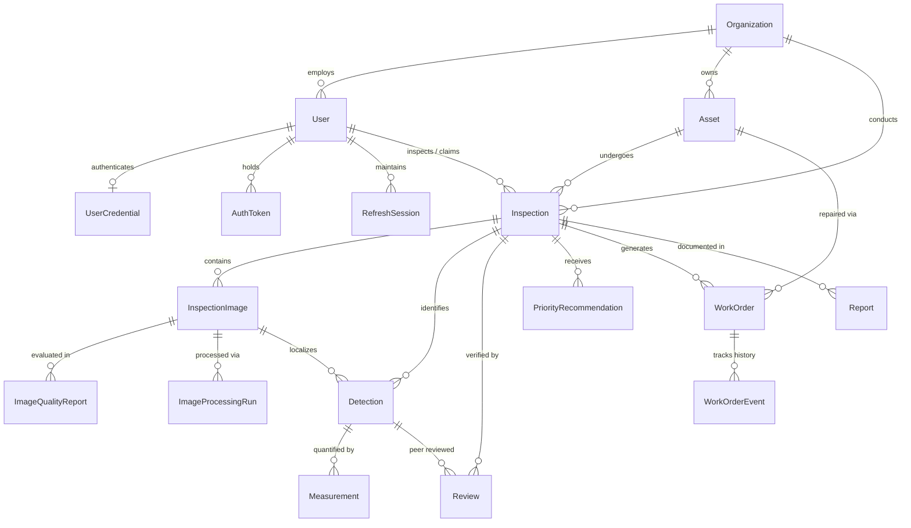
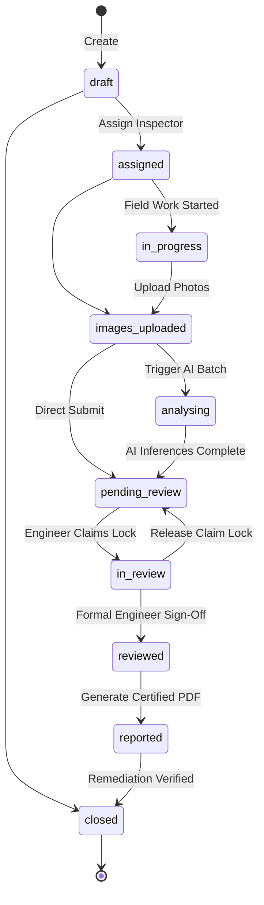

# InfraScan Backend Architecture & API Specification

> **Target Service**: `apps/api` (FastAPI Civil Infrastructure Inspection & AI Damage Assessment Gateway)  
> **Repository Path**: `d:/project/aiml prime/project/infosys/apps/api`  
> **Specification Version**: 1.0.0 (Production Deployment Reference)  
> **Environment Runtime**: Python 3.12+ / FastAPI / SQLAlchemy / PyTorch / OpenCV / ReportLab

---

## Table of Contents
1. [Executive Overview & System Architecture](#1-executive-overview--system-architecture)
2. [Lifespan, Middleware & Request Pipeline](#2-lifespan-middleware--request-pipeline)
3. [Configuration & Operational Limits](#3-configuration--operational-limits)
4. [Database Architecture & Data Models (SQLAlchemy ORM)](#4-database-architecture--data-models-sqlalchemy-orm)
5. [Security, Authentication & RBAC Engine](#5-security-authentication--rbac-engine)
6. [Complete Router Mapping & API Route Specifications](#6-complete-router-mapping--api-route-specifications)
   - [Router 1: Image Capture, Quality & Preprocessing (`upload.py`)](#router-1-image-capture-quality--preprocessing-uploadpy)
   - [Router 2: Authentication & Token Management (`auth.py`)](#router-2-authentication--token-management-authpy)
   - [Router 3: User Profile & Session Governance (`users.py`)](#router-3-user-profile--session-governance-userspy)
   - [Router 4: Inspection Lifecycle & Review Queue (`inspections.py`)](#router-4-inspection-lifecycle--review-queue-inspectionspy)
   - [Router 5: Administrative Operations & Audit (`admin.py`)](#router-5-administrative-operations--audit-adminpy)
   - [Router 6: System Capabilities & Diagnostics (`system.py`)](#router-6-system-capabilities--diagnostics-systempy)
   - [Router 7: Organization Management (`organizations.py`)](#router-7-organization-management-organizationspy)
   - [Router 8: Civil Asset Registry & GIS (`assets.py`)](#router-8-civil-asset-registry--gis-assetspy)
   - [Router 9: Benchmark Datasets & Reference Data (`datasets.py`)](#router-9-benchmark-datasets--reference-data-datasetspy)
   - [Router 10: Event Notifications (`notifications.py`)](#router-10-event-notifications-notificationspy)
   - [Router 11: Multi-Role Operational Dashboards & Search (`dashboards.py`)](#router-11-multi-role-operational-dashboards--search-dashboardspy)
   - [Router 12: Findings & Annotations Engine (`detections.py`)](#router-12-findings--annotations-engine-detectionspy)
   - [Router 13: Maintenance Work Orders & Remediation (`work_orders.py`)](#router-13-maintenance-work-orders--remediation-work_orderspy)
   - [Router 14: Engineering Reports Generator (`reports.py`)](#router-14-engineering-reports-generator-reportspy)
   - [Router 15: Civil Damage Analytics Engine (`analytics.py`)](#router-15-civil-damage-analytics-engine-analyticspy)
   - [Gateway & Root Probes (`main.py`)](#gateway--root-probes-mainpy)
7. [Service Layer & Domain Engines](#7-service-layer--domain-engines)
8. [Hardware Concurrency, Storage Topology & Deployment Guide](#8-hardware-concurrency-storage-topology--deployment-guide)

---

## 1. Executive Overview & System Architecture

The **InfraScan API Gateway** is an asynchronous backend service engineered to support automated, AI-assisted visual inspection, damage quantification, and structural condition monitoring of civil infrastructure (bridges, highways, tunnels, retaining walls, dams, and marine piers).

```
                      +------------------------------------------+
                      |         Frontend Clients (Vite / React)   |
                      +--------------------+---------------------+
                                           | HTTP / Bearer / Cookies
                                           v
+---------------------------------------------------------------------------------------+
| InfraScan API Gateway (FastAPI / Starlette)                                           |
|                                                                                       |
|   +-------------------------------------------------------------------------------+   |
|   | Middleware Pipeline:                                                          |   |
|   |   1. SecurityHeadersMiddleware (CSP, Nosniff, Frame-Options, No-Cache on Auth)|   |
|   |   2. RequestMetricsMiddleware (Latency profiling & DB request_metrics)        |   |
|   |   3. CORSMiddleware (Origin whitelist & credential support)                   |   |
|   +---------------------------------------+---------------------------------------+   |
|                                           |                                           |
|   +---------------------------------------v---------------------------------------+   |
|   | API Routers (v1 /api/v1 + legacy /api compatibility):                         |   |
|   |   * Auth & Sessions       * Inspections Lifecycle   * Detections & Geometry   |   |
|   |   * Assets & GIS          * Work Orders & SLA       * Certified Reports       |   |
|   |   * Image Processing      * Dashboards & Search     * Civil Analytics Engine  |   |
|   |   * System & Diagnostics  * Benchmark Datasets      * Role Notifications      |   |
|   +-------------------+---------------------------------------+-------------------+   |
|                       |                                       |                       |
|   +-------------------v-------------------+       +-----------v-------------------+   |
|   | Domain Service Layer:                 |       | Multi-Stage AI Inference:     |   |
|   |   * Severity Engine (AASHTO / ASTM)   |       |   [GPU Semaphore: 1 Lock]     |   |
|   |   * Priority Engine (P1-P5 Matrix)    |       |   1. ResNet-18 Classifier     |   |
|   |   * Crack Geometry (Skeleton / EDT)   |       |   2. RF-DETR Defect Detector  |   |
|   |   * Optical Quality (pHash / Blur)    |       |   3. YOLOv8 Fallback Detector |   |
|   |   * Certified ReportLab PDF/XLSX      |       |   4. UNet Crack Segmentor     |   |
|   |   * aiosmtplib Notification Dispatcher|       |   5. Geometry & Damage Engine |   |
|   +-------------------+-------------------+       +-----------+-------------------+   |
|                       |                                       |                       |
+-----------------------|---------------------------------------|-----------------------+
                        v                                       v
        +-------------------------------+       +-------------------------------+
        | Persistent Storage & Database |       | Local File System Storage     |
        | - SQLite with WAL Engine      |       | - /storage/uploads            |
        | - 35 Normalized Models        |       | - /storage/thumbnails         |
        | - Automated Schema Migrations |       | - /storage/processed          |
        | - ACID Transactions           |       | - /storage/rfdetr, yolo, unet |
        +-------------------------------+       | - /uploads/reports (PDF/XLSX) |
                                                +-------------------------------+
```

### Core Technology Stack
- **Web Framework**: FastAPI 0.115+ / Starlette 0.40+ (Asynchronous ASGI).
- **ORM & Data Layer**: SQLAlchemy 2.0+ (Declarative mapping with automated SQLite PRAGMA tuning).
- **Data Validation**: Pydantic v2 & Pydantic-Settings (Strict typed schemas).
- **Cryptographic Engine**: Argon2id (`argon2-cffi`), PyJWT (`HS256`), Python `secrets` & `hashlib` (SHA-256).
- **Computer Vision & Image Processing**: OpenCV 4.10+ (`cv2`), Pillow 10.4+, NumPy 1.26+, SciPy.
- **Deep Learning Inferences**: PyTorch 2.5+ / TorchScript / ONNX Runtime with CUDA 12.x hardware acceleration.
- **Document & Spreadsheet Generation**: ReportLab 4.2+ (Certified PDF generation), OpenPyXL (Excel `.xlsx`), standard `csv`/`json`.
- **Mail Service**: `aiosmtplib` (Asynchronous SMTP dispatch).

---

## 2. Lifespan, Middleware & Request Pipeline

### 2.1 Asynchronous Lifespan Management (`app/main.py`)
The application startup and shutdown lifecycle is managed via `@asynccontextmanager def lifespan(app: FastAPI)`:
1. **Database Schema Auto-Creation**:
   - Executes `Base.metadata.create_all(bind=engine)`.
   - Executes `ensure_schema_upgrades(engine)` to idempotently verify and apply incremental column migrations (e.g., `region`, `method`, `analysis_status`, `quality_status`, `alert_level`).
2. **First-Run Administrator Bootstrap Detection**:
   - Queries `User.role == "admin"`. If zero administrative accounts exist, logs prominent CLI instruction (`python -m app.cli create-admin`) and exposes web setup with `settings.SETUP_TOKEN`.
   - Seeds the default root tenant: `Primary Infrastructure Authority`.
3. **Hardware Acceleration Probe**:
   - Inspects `torch.cuda.is_available()`.
   - When CUDA is active, logs device name and total physical memory (e.g., *NVIDIA GeForce RTX 2050 4096 MB VRAM*).
   - Gracefully falls back to CPU execution if no GPU is detected.
4. **AI Pipeline Model Warming**:
   - Preloads and warms up all inference engines at startup to avoid runtime request latency:
     - InfraScan ResNet-18 Classifier (`app.services.classifier.get_classifier()`)
     - RF-DETR Defect Detector (`app.services.rfdetr_detector.get_rfdetr_detector()`)
     - UNet Crack Segmentor (`app.services.unet_segmentor.get_unet_segmentor()`)
     - YOLOv8 Defect Detector (`app.services.yolo_detector.get_yolo_detector()`)

### 2.2 Middleware Pipeline
1. **CORS Middleware (`CORSMiddleware`)**:
   - Allowed origins: `settings.APP_BASE_URL`, `http://localhost:5173`, `http://127.0.0.1:5173`.
   - Supports credentials (`allow_credentials=True`), all HTTP methods (`*`), and all headers (`*`).
2. **Performance Metrics Middleware (`RequestMetricsMiddleware`)**:
   - Measures exact request execution duration using `time.perf_counter()`.
   - Injects HTTP response header: `X-Process-Time-Ms: <duration>`.
   - Filters `/api` paths and records telemetry in the database `request_metrics` table asynchronously.
3. **Security Headers Middleware (`SecurityHeadersMiddleware`)**:
   - Injects mandatory OWASP headers on every response:
     - `X-Content-Type-Options: nosniff`
     - `X-Frame-Options: DENY`
     - `Referrer-Policy: strict-origin-when-cross-origin`
     - `Content-Security-Policy: default-src 'self'; frame-ancestors 'none';`
   - Injects anti-caching headers on authentication endpoints:
     - `Cache-Control: no-store, no-cache, must-revalidate`
     - `Pragma: no-cache`
4. **Validation Exception Handler (`RequestValidationError`)**:
   - Normalizes validation failures into uniform JSON:
     ```json
     {
       "code": "VALIDATION_ERROR",
       "message": "Invalid request parameter",
       "field": "body.email"
     }
     ```

---

## 3. Configuration & Operational Limits

The configuration engine in `app/config.py` inherits from `pydantic_settings.BaseSettings`, parsing environment variables from the root `.env` file with secure fallbacks.

| Variable Name | Type | Default Value | Description |
| :--- | :--- | :--- | :--- |
| `ENVIRONMENT` | `str` | `"development"` | Runtime stage (`development`, `staging`, `production`). |
| `APP_BASE_URL` | `str` | `"http://localhost:5173"` | Frontend origin for CORS and email verification links. |
| `API_BASE_URL` | `str` | `"http://localhost:8000"` | External canonical URL of this API. |
| `DATABASE_URL` | `str` | `"sqlite:///<BASE>/infrascan_dev.db"` | SQLAlchemy database connection URI. |
| `JWT_SECRET` | `str` | `secrets.token_hex(32)` | Cryptographic secret for signing access tokens. |
| `JWT_ALGORITHM` | `str` | `"HS256"` | Symmetric signing algorithm. |
| `ACCESS_TOKEN_EXPIRE_MINUTES` | `int` | `15` | Lifetime of short-lived JWT access tokens. |
| `REFRESH_TOKEN_EXPIRE_DAYS` | `int` | `7` | Lifetime of long-lived rotating refresh sessions. |
| `COOKIE_SECURE` | `bool` | `False` | Enforces `Secure` flag on cookies (must be `True` in production HTTPS). |
| `COOKIE_SAMESITE` | `str` | `"lax"` | Cookie SameSite policy (`lax`, `strict`, `none`). |
| `SMTP_HOST` | `str` | `"localhost"` | Hostname of outbound SMTP relay (e.g. Mailpit). |
| `SMTP_PORT` | `int` | `1025` | SMTP port (1025 for Mailpit local development). |
| `SMTP_USER` | `Optional[str]` | `None` | SMTP authentication username. |
| `SMTP_PASSWORD` | `Optional[str]` | `None` | SMTP authentication password. |
| `MAIL_FROM` | `str` | `"no-reply@infrascan.local"` | Default sender header for transactional emails. |
| `SMTP_STARTTLS` | `bool` | `False` | Enable TLS encryption during SMTP handshake. |
| `GOOGLE_CLIENT_ID` | `Optional[str]` | `None` | OAuth 2.0 Client ID for Google login. |
| `GOOGLE_CLIENT_SECRET` | `Optional[str]` | `None` | OAuth 2.0 Client Secret for Google login. |
| `MICROSOFT_CLIENT_ID` | `Optional[str]` | `None` | Azure AD / Microsoft Client ID. |
| `MICROSOFT_CLIENT_SECRET` | `Optional[str]` | `None` | Azure AD / Microsoft Client Secret. |
| `SETUP_TOKEN` | `str` | `secrets.token_urlsafe(32)` | One-time bootstrap token generated if no admin exists. |

### Operational Limits & Image Quality Thresholds
- **Maximum File Upload Size**: `50 MB` (`MAX_FILE_SIZE_MB = 50`).
- **Minimum Resolution**: Unbounded (`MIN_LONG_SIDE = 0`, `MIN_SHORT_SIDE = 0`) to accommodate variable sensor payloads.
- **Blur Assessment (Laplacian Variance)**:
  - Warning Threshold: `< 80.0` (`BLUR_WARN`)
  - Rejection Failure Threshold: `< 30.0` (`BLUR_FAIL`)
- **Illumination Assessment**:
  - Low Light Warning: `< 70.0` mean grayscale luminance (`LIGHT_WARN`)
  - Low Light Rejection: `< 40.0` mean grayscale luminance (`LIGHT_FAIL`)
- **Perceptual Duplicate Detection (pHash)**:
  - Maximum Hamming Distance: `<= 5` bits (`DUP_HAMMING_MAX`)
- **Preprocessing Pipeline Parameters**:
  - Maximum Output Dimension: `2048 px` (`PROCESSED_MAX_SIDE`)
  - High-Resolution Tiling Trigger: `4096 px` (`TILE_THRESHOLD_PX`)
  - Tile Size: `1024 x 1024 px` (`TILE_SIZE`) with `20%` overlap (`TILE_OVERLAP = 0.20`)
  - Pipeline Execution Timeout: `120 seconds` (`PREPROCESS_TIMEOUT_S`)
  - CLAHE Contrast Clipping Limit: `2.0` (`PREPROCESS_CLAHE_CLIP`) across `8x8` grid tiles
  - Unsharp Mask Sharpening Strength: `0.6` (`PREPROCESS_SHARPEN_STRENGTH`)

---

## 4. Database Architecture & Data Models (SQLAlchemy ORM)

The relational schema is configured in `app/database.py` and defined across `app/models/all_models.py`.

### 4.1 SQLite High-Concurrency WAL Engine Configuration
When operating on SQLite, `app/database.py` registers connection-level PRAGMA hooks to prevent write-lock starvation and maximize concurrency:
```python
PRAGMA journal_mode=WAL          -- Write-Ahead Logging allows concurrent readers during writes
PRAGMA synchronous=NORMAL        -- Balances durability with disk write speed
PRAGMA busy_timeout=60000        -- Waits up to 60s for lock acquisition before raising OperationalError
PRAGMA cache_size=-64000         -- Allocates 64MB RAM page cache per connection
PRAGMA temp_store=MEMORY         -- Stores temporary indices and sorting tables in RAM
```

### 4.2 Comprehensive Catalog of 35 Data Models



#### Category A: Authentication, Identity & Audit
1. `Organization` (`organizations`): Multi-tenant entity with UUID primary key, name, self-registration toggle.
2. `User` (`users`): System actors, role assignment (`admin`, `manager`, `civil-engineer`, `inspector`, `maintenance`), account state (`pending_approval`, `active`, `deactivated`, `locked`), lockout counters.
3. `UserCredential` (`user_credentials`): Isolated Argon2id password hash (`password_hash`) linked 1:1 with user.
4. `AuthToken` (`auth_tokens`): One-time verification tokens (`verify`, `reset`) with SHA-256 hash and 24h expiration.
5. `RefreshSession` (`refresh_sessions`): Long-lived rotating refresh session tokens, IP address, user-agent, and `family_id` for reuse detection.
6. `Invitation` (`invitations`): Secure cryptographically signed invitations created by administrators.
7. `AuditLog` (`audit_log`): Immutable append-only audit trail logging actor, action, target entity, IP address, and sanitized JSON details.
8. `RequestMetric` (`request_metrics`): Telemetry records tracking API path, HTTP method, response code, and latency in milliseconds.
9. `SetupState` (`setup_state`): First-run setup initialization state.

#### Category B: Domain Nomenclature & Reference Data
10. `DefectType` (`defect_types`): Standard defect taxonomy (crack, spalling, corrosion, exposed rebar, potholes).
11. `SeverityLevel` (`severity_levels`): Structural severity classification (`minor`, `moderate`, `severe`, `critical`).
12. `PriorityCategory` (`priority_categories`): Remediation priority tiers (`P1` to `P5`) with associated SLA days.
13. `InfrastructureType` (`infrastructure_types`): Civil asset types (`bridge`, `road`, `tunnel`, `retaining-wall`, `dam`, `pier`).
14. `AlertLevel` (`alert_levels`): Visual indicators (`green`, `blue`, `yellow`, `orange`, `red`).

#### Category C: Asset Inventory & Inspection Operations
15. `Asset` (`assets`): Civil structures with alphanumeric code (e.g. `BR-018`), GIS coordinates (`latitude`, `longitude`), construction year, structural material, region, assigned inspector, and operational criticality.
16. `Inspection` (`inspections`): Scheduled or ad-hoc inspection events, inspector assignment, workflow status, claimed review lock (`claimed_by`, `claimed_at`), inspection method (`walkdown`, `drone`, `dslr`), parent inspection tracking.
17. `InspectionImage` (`inspection_images`): Uploaded photographic assets, original and preprocessed file paths, cryptographic checksums (`sha256`, `phash`), EXIF metadata, scale calibration data, quality status (`accepted`, `warning`, `rejected`), sound concrete verification flag.
18. `ImageQualityReport` (`image_quality_reports`): Granular diagnostic checks (blur score, illumination luminance, exposure, contrast, duplicate distance).
19. `ImageProcessingRun` (`image_processing_runs`): Execution log of image transformations, tiles, metrics before and after processing.
20. `ProcessedImage` (`processed_images`): Preprocessed variant outputs linked to source images.
21. `Notification` (`notifications`): In-app notification messages, alert levels (`informational`, `low`, `medium`, `high`, `critical`), entity deep-links.

#### Category D: Benchmark Datasets & Machine Learning
22. `Dataset` (`datasets`): Public benchmark datasets (e.g., `SDNET2018`, `METU_CCIC`, `RDD2022`, `CRACK500`).
23. `DatasetInspectionStat` (`dataset_inspection_stats`): Metric benchmarks (precision, recall, mAP) across datasets.
24. `DatasetClassStat` (`dataset_class_stats`): Class representation sample counts.

#### Category E: Findings, Quantitative Measurements & Review
25. `Detection` (`detections`): Defect bounding boxes, segmentation polylines, surface polygons, defect type, severity, origin source (`ai_model` vs `engineer_manual`), AI confidence score.
26. `Measurement` (`measurements`): Derived physical dimensions (`length`, `avg_width`, `max_width`, `area`, `orientation`, `branching`, `continuity`, `density`, `unit`, `uncertainty`, `calibrated`).
27. `Review` (`reviews`): Peer review audit records logging reviewer decision (`created`, `confirmed`, `corrected`, `rejected`), previous value snapshot, new value snapshot, engineering justification.
28. `PriorityRecommendation` (`priority_recommendations`): Multi-factor priority recommendation generated by priority engine, confirmed or overridden by civil engineer.

#### Category F: Engineering Rules & Templates
29. `SeverityRule` (`severity_rules`): Configurable severity weights (crack width 35%, length 20%, density 20%, damage type 15%, material 10%) and thresholds.
30. `PriorityRule` (`priority_rules`): Priority weights (severity 40%, importance 25%, progression 15%, history 10%, asset type 10%) and risk multipliers.
31. `RepairTaskTemplate` (`repair_task_templates`): Standard engineering remediation procedures (epoxy injection, polyurethane grouting, milling overlay, sacrificial anodes).

#### Category G: Maintenance, Temporal Comparison & Certified Reports
32. `WorkOrder` (`work_orders`): Remediation work tickets (`WO-001`), prescribed action, priority SLA, assigned contractor/team, target completion date, workflow state (`unassigned`, `open`, `in_progress`, `closed`).
33. `WorkOrderEvent` (`work_order_events`): State transition history with actor ID, status changes, and closure notes.
34. `InspectionComparison` (`inspection_comparisons`): Temporal comparison between two inspections of the same asset, homography matrix transform, feature inlier ratio, crack growth delta.
35. `Report` (`reports`): Certified inspection reports in PDF, XLSX, CSV, or JSON format with SHA-256 integrity checksum and generating engineer signature.

---

## 5. Security, Authentication & RBAC Engine

```
+-----------------------------------------------------------------------------------------------+
|                                      Role Hierarchy & RBAC                                    |
+-----------------------------------------------------------------------------------------------+
| Administrator       : Full system control, user approvals, invitations, system diagnostics    |
| Civil Engineer      : Inspection reviews, annotation verification, priority sign-off, reports |
| Field Inspector     : Asset inspection execution, image capture & upload, baseline notes      |
| Infrastructure Mgr  : Operational dashboards, cross-asset analytics, read-only reviewed data  |
| Maintenance Eng     : Remediation work orders, task status transitions, execution tracking    |
+-----------------------------------------------------------------------------------------------+
```

### 5.1 Password Hashing & Policy
- **Algorithm**: Argon2id via `argon2-cffi`.
- **Parameters**: `time_cost=2`, `memory_cost=65536` (64 MB RAM), `parallelism=1`, `hash_len=32`, `salt_len=16`.
- **Policy Enforcement**:
  - Length: Minimum 12 characters, maximum 128 characters.
  - Blacklist: Prevents trivial patterns (e.g. `password1234`, `infrascan123`, `administrator`).
  - Identity Isolation: Forbids passwords containing parts of user's name or email username.

### 5.2 Authentication Workflows
1. **Local Self-Registration**:
   - Submits `fullName`, `email`, `password`, `requestedRole`, `organizationId`.
   - Administrator role (`admin`) cannot be self-requested (HTTP 400 rejection).
   - Generates 24-hour cryptographically secure email verification token (`AuthToken`).
   - Dispatches transactional verification email via SMTP.
   - Account enters `pending_approval` state until verified and approved by an administrator.
2. **Account Lockout Protection**:
   - Tracks consecutive failed attempts in `User.failed_login_attempts`.
   - On the 5th consecutive failure, locks account for 15 minutes (`User.locked_until = now + 15m`).
   - Rejects authentication attempts with HTTP 423 Locked and dispatches security alert email.
3. **Google OAuth 2.0 Integration**:
   - Exposes `/auth/google/callback` for authorization code exchange.
   - Retrieves verified email and identity profile from Google OAuth2 API.
   - Auto-provisions user into local database with verified email.

### 5.3 Dual-Token Session Architecture
- **Access Token**: Short-lived JWT signed with `HS256`, valid for 15 minutes. Payload contains `sub` (User ID), `role`, and `email`.
- **Refresh Token**: Cryptographically random 48-byte token (`secrets.token_urlsafe(48)`), valid for 7 days.
  - Stored in database exclusively as a SHA-256 digest (`RefreshSession.token_hash`).
  - Delivered to client inside an `HttpOnly`, `SameSite=Lax`, `Secure` cookie named `infrascan_refresh`.
  - Employs **Token Family Rotation**: Every refresh request revokes the previous token and issues a new one. If an already-revoked refresh token is presented, the entire session family is invalidated immediately to defeat token theft.

### 5.4 Token Extraction & Dependency Resolution
The `get_current_user` dependency extracts credentials in the following precedence order:
1. HTTP Authorization Header: `Bearer <token>`
2. Query Parameter: `?token=<token>` (facilitates authenticated media streaming)
3. Cookie: `infrascan_access`
4. Cookie: `access_token`
5. Fallback: Active, unexpired, unrevoked `infrascan_refresh` session cookie

### 5.5 Granular Role Visibility Rules (Section 6.5)
- **Field Inspector**: Accesses all data and images for their assigned inspections. Restricted from cross-inspector unassigned work.
- **Civil Engineer & Administrator**: Unrestricted visibility across all inspections, raw quality reports, unreviewed images, and AI findings.
- **Infrastructure Manager & Maintenance Engineer**: Strictly restricted from raw quality reports or intermediate preprocessed files. They can only access reviewed images once an inspection has achieved `reviewed`, `reported`, or `closed` status.

---

## 6. Complete Router Mapping & API Route Specifications

The application exposes **212 total endpoint operations** mapped across 15 modular routers in `apps/api/app/routers`.

---

### Router 1: Image Capture, Quality & Preprocessing (`upload.py`)
Mounted at `/api/v1` and aliased at `/api` for frontend client compatibility.

| Method | Path | Summary / Responsibility | Auth / Roles |
| :--- | :--- | :--- | :--- |
| `GET` | `/config/image-limits` | Returns image size limits, blur/lighting thresholds, tile limits | Public |
| `POST` | `/images/assess` | Standalone image quality assessment without saving to DB | Authenticated |
| `POST` | `/inspections/{id}/images` | Uploads inspection photograph, runs blur/lighting checks, generates thumbnail | Inspector, Engineer, Admin |
| `POST` | `/images/upload` | Direct upload alias with `inspection_id` form parameter | Inspector, Engineer, Admin |
| `GET` | `/inspections/{id}/images` | Lists all image records, quality states, and thumbnails for inspection | Role-based visibility |
| `GET` | `/images/{image_id}` | Detailed image metadata, calibration, quality report, processing runs | Role-based visibility |
| `GET` | `/images/{image_id}/file` | Streams original, thumbnail, or processed image binary with caching headers | Role-based visibility |
| `GET` | `/images/{image_id}/thumbnail` | Shortcut route to stream 256px JPEG thumbnail | Role-based visibility |
| `GET` | `/images/{image_id}/processed` | Shortcut route to stream preprocessed variant image | Role-based visibility |
| `GET` | `/images/{image_id}/rfdetr` | Streams visual defect detection overlay generated by RF-DETR | Role-based visibility |
| `GET` | `/images/{image_id}/yolo` | Streams visual defect detection overlay generated by YOLOv8 | Role-based visibility |
| `GET` | `/images/{image_id}/unet` | Streams binary/colored crack segmentation mask generated by UNet | Role-based visibility |
| `GET` | `/images/{image_id}/mask` | Shortcut alias for crack segmentation mask stream | Role-based visibility |
| `GET` | `/images/{image_id}/geometry/file` | Streams rendered crack geometry visualization with skeleton and width markers | Role-based visibility |
| `GET` | `/images/{image_id}/geometry` | Retrieves quantitative geometry JSON (width, length, area, branches) | Authenticated |
| `POST` | `/images/{image_id}/geometry` | Triggers crack geometry calculation with optional mm/pixel calibration | Engineer, Admin |
| `POST` | `/images/{image_id}/quality/confirm` | Confirms and overrides image quality warning with engineering justification | Engineer, Admin |
| `POST` | `/images/{image_id}/confirm-sound` | Marks image surface as verified sound concrete, clearing false defects | Engineer, Admin |
| `DELETE`| `/images/{image_id}/confirm-sound` | Revokes sound concrete certification, re-enabling defect annotations | Engineer, Admin |
| `POST` | `/images/{image_id}/preprocess` | Runs CLAHE enhancement, bilateral denoising, unsharp masking | Inspector, Engineer, Admin |
| `POST` | `/images/{image_id}/processing/retry` | Re-executes failed image preprocessing run | Engineer, Admin |
| `POST` | `/images/{image_id}/analyze` | Executes multi-stage AI pipeline (ResNet -> RF-DETR -> YOLO -> UNet -> Geometry)| Engineer, Admin |
| `POST` | `/images/{image_id}/calibration` | Establishes physical scale calibration (manual line or mm/px ratio) | Engineer, Admin |
| `DELETE`| `/images/{image_id}/calibration` | Deletes physical calibration, reverting measurements to pixel units | Engineer, Admin |
| `POST` | `/images/{image_id}/transform` | Performs lossless rotation (90/180/270), crop, flip, or perspective warp | Engineer, Admin |
| `POST` | `/images/{image_id}/replace` | Replaces rejected or corrupted image file, preserving ID and history | Inspector, Engineer, Admin |
| `POST` | `/images/{image_id}/review` | Records engineering peer review decision on image | Engineer, Admin |
| `POST` | `/images/{image_id}/annotations` | Saves manual polygonal or polyline finding annotation directly to image | Engineer, Admin |
| `DELETE`| `/images/{image_id}` | Soft-deletes image record (fails with 423 if inspection is sealed) | Inspector, Engineer, Admin |
| `GET` | `/images/{image_id}/augmentations` | Generates on-the-fly photometric augmentations for visual verification | Engineer, Admin |
| `GET` | `/images/datasets/samples` | Lists benchmark public dataset samples available for import | Authenticated |
| `POST` | `/images/datasets/import` | Imports public dataset image directly into active inspection | Engineer, Admin |
| `GET` | `/images/{image_id}/xai` | Returns Explainable AI metadata (target/pred class, confidence, hotspot %, URLs)| Authenticated |
| `GET` | `/images/{image_id}/gradcam` | Shortcut route to stream pure or blended Grad-CAM heatmap overlay | Role-based visibility |
| `GET` | `/images/{image_id}/gradcam-pp` | Shortcut route to stream pure or blended Grad-CAM++ high-order heatmap | Role-based visibility |
| `GET` | `/images/{image_id}/attention` | Shortcut route to stream spatial feature activation energy attention map | Role-based visibility |
| `GET` | `/images/{image_id}/saliency` | Shortcut route to stream input pixel-level gradient saliency map | Role-based visibility |

---

### Router 2: Authentication & Token Management (`auth.py`)
Mounted at `/api/v1/auth`.

| Method | Path | Summary / Responsibility | Auth / Roles |
| :--- | :--- | :--- | :--- |
| `GET` | `/providers` | Returns list of active OAuth providers (`google`, `microsoft`) | Public |
| `POST` | `/google/callback` | Exchanges Google OAuth authorization code for authenticated session | Public |
| `GET` | `/setup/status` | Checks if first-time administrative setup is required | Public |
| `POST` | `/setup` | Creates primary administrator account using `SETUP_TOKEN` | Public (One-Time) |
| `POST` | `/register` | Registers new user account with requested role and sends verification email | Public |
| `POST` | `/verify-email` | Verifies account email address via cryptographic token | Public |
| `POST` | `/resend-verification` | Resends verification token email (generic non-enumerating response) | Public |
| `POST` | `/login` | Authenticates email & password, enforces 5-attempt lockout, sets tokens | Public |
| `POST` | `/token/refresh` | Rotates refresh session cookie and issues new short-lived JWT access token | Cookie Auth |
| `POST` | `/logout` | Revokes active refresh session family and clears auth cookies | Authenticated |
| `POST` | `/forgot-password` | Generates password reset token and dispatches reset email | Public |
| `POST` | `/reset-password` | Updates password using validated reset token | Public |
| `POST` | `/accept-invite` | Activates account and sets password using administrator invite token | Public |
| `GET` | `/me` | Returns current authenticated user profile, role, and organization | Authenticated |

---

### Router 3: User Profile & Session Governance (`users.py`)
Mounted at `/api/v1/me` and `/api/v1/users/me`.

| Method | Path | Summary / Responsibility | Auth / Roles |
| :--- | :--- | :--- | :--- |
| `GET` | `/me` | Retrieves profile of currently authenticated user | Authenticated |
| `PATCH`| `/me` | Updates display name or profile metadata | Authenticated |
| `POST` | `/me/password` | Changes user password (verifies current password, enforces 12-char rules)| Authenticated |
| `GET` | `/me/sessions` | Lists all active refresh sessions, IP addresses, user agents, last used dates | Authenticated |
| `DELETE`| `/me/sessions/{session_id}` | Terminates specific active session remotely | Authenticated |
| `POST` | `/me/sessions/revoke-others` | Terminates all other active sessions except current session | Authenticated |

---

### Router 4: Inspection Lifecycle & Review Queue (`inspections.py`)
Mounted at `/api/v1/inspections`.

| Method | Path | Summary / Responsibility | Auth / Roles |
| :--- | :--- | :--- | :--- |
| `POST` | `/inspections` | Creates inspection record with asset link, inspector, and due dates | Admin, Manager, Inspector |
| `GET` | `/inspections` | Lists inspections with filters (asset, status, inspector, dates, pagination) | Role-filtered |
| `GET` | `/inspections/inspectors` | Lists active field inspectors available for task assignment | Admin, Manager |
| `GET` | `/inspections/{id}` | Complete inspection details, asset data, images, findings, sign-off status | Role-filtered |
| `GET` | `/inspections/{id}/damage-assessment`| Computes aggregated damage metrics, severity distribution, suggested repair | Authenticated |
| `PATCH`| `/inspections/{id}/status` | Enforces server-side status lifecycle state machine transitions | Role-checked |
| `PATCH`| `/inspections/{id}/reassign` | Reassigns inspection to a different field inspector | Admin, Manager |
| `POST` | `/inspections/{id}/submit-for-review`| Field inspector submits completed inspection for engineering peer review | Inspector, Admin |
| `POST` | `/inspections/{id}/submit` | Alias for inspection review submission | Inspector, Admin |
| `POST` | `/inspections/{id}/claim` | Civil engineer claims exclusive review lock on inspection (`claimed_by`) | Civil Engineer, Admin |
| `POST` | `/inspections/{id}/release-claim` | Releases claimed review lock, returning inspection to open review queue | Claimant, Admin |
| `POST` | `/inspections/{id}/analyze` | Triggers batch AI pipeline across all unanalyzed images in inspection | Engineer, Admin |
| `POST` | `/inspections/{id}/images/{img_id}/analyze`| Triggers AI pipeline on single image within inspection context | Engineer, Admin |
| `GET` | `/inspections/{id}/priority-preview` | Previews dynamic priority calculation based on findings and asset risks | Civil Engineer, Admin |
| `POST` | `/inspections/{id}/confirm-priority` | Confirms or overrides calculated priority (P1-P5) with engineering justification | Civil Engineer, Admin |
| `POST` | `/inspections/{id}/sign-off` | Formal engineering sign-off, seals image set, transitions to `reviewed` | Civil Engineer, Admin |
| `POST` | `/inspections/{id}/close` | Formally closes inspection following report generation and remediation | Admin, Manager |
| `GET` | `/inspections/{id}/compare/{other_id}`| Feature matching & homography comparison with historical baseline inspection| Civil Engineer, Admin |



---

### Router 5: Administrative Operations & Audit (`admin.py`)
Mounted at `/api/v1/admin`.

| Method | Path | Summary / Responsibility | Auth / Roles |
| :--- | :--- | :--- | :--- |
| `GET` | `/admin/pending-users` | Lists all registered users awaiting administrative role approval | Admin Only |
| `POST` | `/admin/users/{id}/approve` | Approves pending user, confirms role assignment, dispatches welcome email | Admin Only |
| `POST` | `/admin/users/{id}/reject` | Rejects pending user application with mandatory reason notification | Admin Only |
| `POST` | `/admin/users/{id}/deactivate` | Deactivates active user account, invalidating all sessions | Admin Only |
| `POST` | `/admin/invitations` | Generates cryptographically secure invitation token and dispatches email | Admin Only |
| `GET` | `/admin/audit-log` | Searchable, paginated audit log with action, actor, date, entity filters | Admin Only |
| `GET` | `/admin/health` | Diagnostic platform health (DB latency, storage stats, memory, error rates)| Admin Only |

---

### Router 6: System Capabilities & Diagnostics (`system.py`)
Mounted at `/api/v1/system`.

| Method | Path | Summary / Responsibility | Auth / Roles |
| :--- | :--- | :--- | :--- |
| `GET` | `/system/capabilities` | Returns CUDA device, VRAM, loaded AI models, OpenCV version, image limits | Authenticated |
| `GET` | `/system/health` | Probes database read/write latency, disk storage availability, process memory | Public / Health Check |

---

### Router 7: Organization Management (`organizations.py`)
Mounted at `/api/v1/organizations`.

| Method | Path | Summary / Responsibility | Auth / Roles |
| :--- | :--- | :--- | :--- |
| `GET` | `/organizations/public` | Lists public organizations available for self-registration selection | Public |

---

### Router 8: Civil Asset Registry & GIS (`assets.py`)
Mounted at `/api/v1/assets`.

| Method | Path | Summary / Responsibility | Auth / Roles |
| :--- | :--- | :--- | :--- |
| `POST` | `/assets` | Creates new civil infrastructure asset (bridge, road, tunnel, dam) | Admin, Manager |
| `GET` | `/assets` | Lists assets with filtering (type, department, region, active, search, pagination)| Authenticated |
| `GET` | `/assets/map-summary` | Returns GIS GeoJSON payload with coordinates, health index, alert colors | Authenticated |
| `GET` | `/assets/{asset_id}` | Detailed asset record, construction year, inspection history, work orders | Authenticated |
| `PUT` | `/assets/{asset_id}` | Updates asset specifications, structural material, GPS coordinates | Admin, Manager |
| `POST` | `/assets/{asset_id}/deactivate` | Soft-deactivates asset from active inspection scheduling | Admin, Manager |
| `POST` | `/assets/{asset_id}/assign` | Designates primary assigned field inspector for asset | Admin, Manager |
| `POST` | `/assets/import-csv` | Batch imports civil asset inventory from uploaded CSV file | Admin, Manager |
| `GET` | `/assets/export/csv` | Exports complete asset inventory database as downloadable CSV | Admin, Manager |

---

### Router 9: Benchmark Datasets & Reference Data (`datasets.py`)
Mounted at `/api/v1`.

| Method | Path | Summary / Responsibility | Auth / Roles |
| :--- | :--- | :--- | :--- |
| `GET` | `/reference-data` | Returns global defect types, severity levels, priority categories, asset types| Authenticated |
| `GET` | `/datasets` | Lists catalog of public infrastructure training & benchmark datasets | Authenticated |
| `GET` | `/datasets/{dataset_id}` | Detailed dataset metadata, class distribution, mAP and benchmark metrics | Authenticated |

---

### Router 10: Event Notifications (`notifications.py`)
Mounted at `/api/v1/notifications`.

| Method | Path | Summary / Responsibility | Auth / Roles |
| :--- | :--- | :--- | :--- |
| `GET` | `/notifications` | Retrieves authenticated user notification feed with unread count and filters | Authenticated |
| `POST` | `/notifications/{id}/read` | Marks single notification as read | Authenticated |
| `POST` | `/notifications/read-all` | Marks all notifications for user as read | Authenticated |

---

### Router 11: Multi-Role Operational Dashboards & Search (`dashboards.py`)
Mounted at `/api/v1`.

| Method | Path | Summary / Responsibility | Auth / Roles |
| :--- | :--- | :--- | :--- |
| `GET` | `/pipeline/counts` | Returns live aggregate counts across all kanban stages of inspection pipeline| Authenticated |
| `GET` | `/dashboard/{role}` | Returns tailored KPI metrics for role (`inspector`, `engineer`, `manager`, etc.)| Authenticated |
| `GET` | `/dashboards/{role}` | Plural route alias for role dashboard metrics | Authenticated |
| `GET` | `/search` | Global full-text search across assets, inspections, findings, and work orders| Authenticated |
| `GET` | `/review-queue` | Returns prioritized queue of inspections awaiting civil engineer review | Civil Engineer, Admin |
| `GET` | `/exports/dashboard/{role}`| Generates downloadable CSV containing role-specific operational metrics | Authenticated |

---

### Router 12: Findings & Annotations Engine (`detections.py`)
Mounted at `/api/v1`.

| Method | Path | Summary / Responsibility | Auth / Roles |
| :--- | :--- | :--- | :--- |
| `GET` | `/inspections/{id}/detections` | Lists all findings, coordinates, measurements, and verification states | Authenticated |
| `POST` | `/inspections/{id}/detections` | Creates manual finding (polyline or polygon) with real-time geometry calculation| Civil Engineer, Admin |
| `PATCH`| `/detections/{detection_id}` | Edits defect classification, geometry points, or overrides severity with audit| Civil Engineer, Admin |
| `DELETE`| `/detections/{detection_id}` | Removes incorrect finding and recalculates inspection damage metrics | Civil Engineer, Admin |
| `POST` | `/detections/{id}/verify-geometry`| Formally certifies finding geometry and measurements as verified | Civil Engineer, Admin |
| `POST` | `/inspections/{id}/mark-no-defects`| Certifies that inspection imagery contains zero structural defects | Civil Engineer, Admin |

---

### Router 13: Maintenance Work Orders & Remediation (`work_orders.py`)
Mounted at `/api/v1`.

| Method | Path | Summary / Responsibility | Auth / Roles |
| :--- | :--- | :--- | :--- |
| `GET` | `/repair-templates` | Lists standard engineering remediation templates (epoxy, grouting, overlay) | Authenticated |
| `GET` | `/work-orders` | Lists maintenance work orders with priority, status, and asset filters | Admin, Mgr, Eng, Maint |
| `POST` | `/work-orders` | Generates remediation work order linked to asset, inspection, and finding | Admin, Mgr, Eng |
| `GET` | `/work-orders/{wo_id}` | Retrieves detailed work order ticket, transition events, finding coordinates | Admin, Mgr, Eng, Maint |
| `PATCH`| `/work-orders/{wo_id}` | Updates prescribed action, assigned contractor team, or due date | Admin, Mgr, Eng |
| `POST` | `/work-orders/{wo_id}/transition`| Transitions work order lifecycle (`unassigned` -> `open` -> `in_progress` -> `closed`)| Admin, Mgr, Eng, Maint |

---

### Router 14: Engineering Reports Generator (`reports.py`)
Mounted at `/api/v1`.

| Method | Path | Summary / Responsibility | Auth / Roles |
| :--- | :--- | :--- | :--- |
| `GET` | `/inspections/{id}/reports` | Lists all generated certified report documents and checksums for inspection | Authenticated |
| `POST` | `/inspections/{id}/reports/generate`| Generates certified engineering report in specified format (`pdf`, `xlsx`, `csv`, `json`)| Civil Engineer, Admin |
| `GET` | `/reports/{report_id}/download` | Authenticated file stream download of report document by report UUID | Authenticated |
| `GET` | `/inspections/{id}/reports/download`| Downloads latest certified report document for inspection | Authenticated |
| `GET` | `/inspections/{id}/reports/{fmt}` | Streams report directly in requested format (`pdf`, `xlsx`, `csv`, `json`) | Authenticated |

---

### Router 15: Civil Damage Analytics Engine (`analytics.py`)
Mounted at `/api/v1/analytics`.

| Method | Path | Summary / Responsibility | Auth / Roles |
| :--- | :--- | :--- | :--- |
| `GET` | `/analytics/overview` | Core KPIs: Defect Detection Rate (DDR), High-Priority Rate (HPR), MTTR | Authenticated |
| `GET` | `/analytics/damage-distribution` | Defect counts grouped by type (crack, spalling, corrosion) and severity | Authenticated |
| `GET` | `/analytics/crack-progression` | Temporal crack growth progression across historical inspections of asset | Authenticated |
| `GET` | `/analytics/risk-matrix` | 5x5 asset risk matrix mapping structural probability vs failure consequence | Authenticated |
| `GET` | `/analytics/maintenance-velocity`| Mean Time to Repair (MTTR) and SLA compliance rates over time | Authenticated |
| `GET` | `/analytics/export` | Exports analytics dataset to CSV for external civil engineering software | Authenticated |

---

### Gateway & Root Probes (`main.py`)

| Method | Path | Summary / Responsibility | Auth / Roles |
| :--- | :--- | :--- | :--- |
| `GET` | `/` | API Gateway root status, version, and link to interactive documentation | Public |
| `GET` | `/health` | Lightweight service health ping | Public |
| `GET` | `/ready` | Readiness probe for container orchestrators (Kubernetes / Docker Compose) | Public |
| `GET` | `/api/models/active` | Active AI models status, versions, loaded engines, and hardware device | Public |
| `GET` | `/api/v1/models/active` | Active AI models status alias | Public |

---

## 7. Service Layer & Domain Engines

The `apps/api/app/services` package houses the core business logic, civil engineering algorithms, and asynchronous integrations.

```
apps/api/app/services/
├── audit.py                # Tamper-evident sanitizing audit logger
├── email.py                # Asynchronous SMTP client (aiosmtplib)
├── image_quality.py        # Laplacian blur, illumination, pHash duplicate detector
├── image_validation.py     # Magic byte format verification and EXIF extraction
├── preprocessing.py        # CLAHE contrast, bilateral noise filter, tiling engine
├── crack_geometry.py       # Morphological skeletonization & Euclidean Distance Transform
├── geometry.py             # Geometric polyline integration and physical calibration
├── severity_engine.py      # Multi-factor AASHTO/ASTM severity scoring
├── priority_engine.py      # Infrastructure risk matrix & maintenance priority (P1-P5)
├── damage_assessment.py    # Calibrated vs Uncalibrated scale-invariant appraisal
├── registration.py         # Temporal feature matching & homography registration
├── reporting.py            # Certified PDF (ReportLab), Excel (.xlsx), CSV, JSON generator
├── explainable_ai.py       # Explainable AI (Grad-CAM, Grad-CAM++, Attention, Saliency)
├── classifier.py           # ResNet-18 crack classification gate service
├── rfdetr_detector.py      # Primary RF-DETR defect detector (FP16 GPU)
├── yolo_detector.py        # Fallback YOLOv8 defect detector
└── unet_segmentor.py       # UNet semantic crack segmentation model
```

### 7.1 Civil Damage & Severity Evaluation (`damage_assessment.py` & `severity_engine.py`)
Adheres to AASHTO and ASTM C856 civil standards. Operates across two operational pathways:
1. **Calibrated Physical Scale (mm)**:
   - Minor: Peak width `< 3.0 mm` (Hairline `< 1.0 mm`) and crack surface density `< 2.0%`.
   - Moderate: Peak width `3.0 mm - 5.0 mm` or crack surface density `2.0% - 5.0%`.
   - Severe: Peak width `5.0 mm - 8.0 mm`, crack surface density `5.0% - 9.0%`, or branch junctions `> 10`.
   - Critical: Peak width `> 8.0 mm`, crack surface density `> 9.0%`, branch junctions `> 50`, or spalling with exposed rebar.
2. **Uncalibrated Scale-Invariant Mode**:
   - Strictly avoids fabricating fictitious millimeter dimensions when no calibration reference is present.
   - Evaluates structural severity through Crack Surface Density `%`, Relative Peak Thickness Ratio $R$, defect morphology, and topological branch count.

### 7.2 Crack Geometry & Morphological Thinning (`crack_geometry.py`)
1. **Binarization & Thresholding**: Applies Otsu adaptive thresholding to segmentation masks.
2. **Morphological Thinning / Skeletonization**: Iteratively reduces binary crack masks to 1-pixel wide central axes (`skimage.morphology.skeletonize` / Zhang-Suen).
3. **Euclidean Distance Transform (EDT)**: Computes the exact minimum Euclidean distance from each skeleton pixel to the nearest non-crack boundary. Multiplying by 2 yields orthogonal crack width at every skeleton coordinate.
4. **Topological Junction Detection**: Convolves a $3 \times 3$ kernel over the skeleton to identify pixel neighborhoods with $> 2$ connectivity transitions, identifying crack branching nodes.

### 7.3 Multi-Format Certified Report Engine (`reporting.py`)
Generates formal engineering reports compliant with municipal infrastructure standards:
- **PDF Generation**: Built with ReportLab `SimpleDocTemplate` on Letter/A4 format. Includes document header, asset metadata table, reviewer credentials, quantitative defect measurement tables, engineering disclaimer, and SHA-256 integrity checksum.
- **Excel Generation**: Formats multi-tab spreadsheets using `openpyxl`.
- **Integrity Verification**: Generates cryptographic SHA-256 hash of output files, stored in `Report.checksum` to detect tampering.

### 7.4 Explainable AI (XAI) Engine (`explainable_ai.py`)
Implements transparent visual feature attribution for civil engineering decision support with distinct mathematical formulations:
- **Grad-CAM**: Evaluates first-order gradient of target classification logits with respect to ResNet-18 `layer4` convolutional feature maps ($512 \times 7 \times 7$). Positive activations are rectified with ReLU and scaled, providing coarse macroscopic semantic attribution.
- **Grad-CAM++**: Utilizes second- and third-order gradient weighting with 95th-percentile non-linear exponential sharpening ($S = \text{Norm}^{1.8}$) to isolate fine hairline crack epicenters without dominant background concrete artifacts.
- **Spatial Feature Attention**: Multi-scale activation energy combining ResNet-18 `layer3` ($14 \times 14$, weight 0.35) and `layer4` ($7 \times 7$, weight 0.65) via channel $L_2$ norm, capturing rich structural fracture geometry independent of class gradients.
- **Input Pixel Saliency**: Measures raw input pixel attribution via gradient magnitude with respect to the input tensor ($\max_c |\nabla_X Y^c|$), enhanced via 98th-percentile contrast stretching and bilateral edge-preserving filtering to reveal crisp fracture trajectories.
- **Robust Algorithmic Fallbacks**: If PyTorch model weights are uninitialized, distinct morphological heuristics (CLAHE/adaptive thresholding, morphological skeletonization, multi-scale Gaussian energy, Sobel/Scharr edge gradients) guarantee method divergence (>10% pairwise).
- **Dual Representation & Colormap Support**: Generates both `pure` (colormap heatmap on transparent/solid background) and `blend` (alpha blended overlay) images across `turbo`, `jet`, and `viridis` palettes. Cached in `storage/xai/{image_id}_{method}_{pure|blend}_{colormap}.jpg` with full JSON metadata.

---

## 8. Hardware Concurrency, Storage Topology & Deployment Guide

### 8.1 Hardware Concurrency & GPU VRAM Throttling
In systems equipped with consumer or edge GPUs (e.g. NVIDIA GeForce RTX 2050 with 4GB VRAM), executing concurrent tensor operations across multiple worker threads can trigger CUDA Out-Of-Memory (OOM) fatal crashes.

To guarantee operational stability, `upload.py` implements a process-wide GPU Semaphore:
```python
import threading
gpu_inference_lock = threading.Semaphore(1)

# In inference execution:
with gpu_inference_lock:
    # 1. ResNet-18 Classification Gate
    # 2. RF-DETR / YOLO Defect Detection
    # 3. UNet Segmentation
    # 4. Torch CUDA cache cleanup
    if torch.cuda.is_available():
        torch.cuda.empty_cache()
```
This forces serialized GPU memory allocation while allowing unbounded concurrent asynchronous I/O for HTTP request handling, metadata queries, and static asset streaming.

### 8.2 File Storage Directory Topology
The storage subsystem automatically resolves and initializes persistent directories:
```
apps/api/
├── storage/
│   ├── uploads/            # Raw, immutable uploaded inspection photographs
│   ├── thumbnails/         # 256px JPEG fast preview thumbnails
│   ├── processed/          # CLAHE-enhanced, normalized, and cropped variants
│   ├── yolo/               # YOLOv8 bounding box overlay visualizations
│   ├── rfdetr/             # RF-DETR bounding box overlay visualizations
│   ├── unet/               # UNet binary and color-coded segmentation masks
│   ├── geometry/           # Rendered skeleton and width marker diagnostic plots
│   └── xai/                # Explainable AI Grad-CAM, Attention, Saliency heatmaps & JSON metadata
├── uploads/
│   └── reports/            # Certified PDF, XLSX, CSV, and JSON report files
└── infrascan_dev.db        # SQLite database file (accompanied by -wal and -shm files)
```

### 8.3 CLI Administration Utility (`app/cli.py`)
The backend provides a dedicated administrative command-line interface:
- **Initialize Tables**: `python -m app.cli init-db`
- **Create First Administrator**: `python -m app.cli create-admin --email admin@infrascan.gov --name "Chief Engineer"`
- **Seed Reference Data**: `python -m app.cli seed-reference`
- **Import Assets from CSV**: `python -m app.cli import-assets --file assets.csv`

### 8.4 Production Deployment Configuration

#### Environment Configuration (.env)
```ini
ENVIRONMENT=production
APP_BASE_URL=https://infrascan.yourdomain.com
API_BASE_URL=https://api.infrascan.yourdomain.com
DATABASE_URL=sqlite:////var/lib/infrascan/infrascan_prod.db
JWT_SECRET=b63f25c7e39a84f09d8e7c6b5a4f3e2d1c0b9a8f7e6d5c4b3a2f1e0d9c8b7a6
ACCESS_TOKEN_EXPIRE_MINUTES=15
REFRESH_TOKEN_EXPIRE_DAYS=7
COOKIE_SECURE=True
COOKIE_SAMESITE=lax
SMTP_HOST=smtp.sendgrid.net
SMTP_PORT=587
SMTP_USER=apikey
SMTP_PASSWORD=SG.your_api_key_here
MAIL_FROM=inspections@yourdomain.com
SMTP_STARTTLS=True
```

#### ASGI Server Command (Uvicorn / Gunicorn)
Run via the dedicated virtual environment with `uv`:
```bash
# Using uv and Uvicorn with 4 worker processes
uv run uvicorn app.main:app \
  --host 0.0.0.0 \
  --port 8000 \
  --workers 4 \
  --proxy-headers \
  --forwarded-allow-ips "*"
```
*Note: For single GPU setups with 4GB VRAM, configure 1 primary worker or rely on worker threading with the `gpu_inference_lock` semaphore.*

#### Nginx Reverse Proxy Configuration
```nginx
server {
    listen 443 ssl http2;
    server_name api.infrascan.yourdomain.com;

    client_max_body_size 60M;  # Accommodates 50MB file uploads + form overhead

    ssl_certificate /etc/letsencrypt/live/api.infrascan.yourdomain.com/fullchain.pem;
    ssl_certificate_key /etc/letsencrypt/live/api.infrascan.yourdomain.com/privkey.pem;

    location / {
        proxy_pass http://127.0.0.1:8000;
        proxy_set_header Host $host;
        proxy_set_header X-Real-IP $remote_addr;
        proxy_set_header X-Forwarded-For $proxy_add_x_forwarded_for;
        proxy_set_header X-Forwarded-Proto $scheme;
        proxy_read_timeout 180s;
        proxy_connect_timeout 60s;
    }
}
```

---
*Authored by `backend_auditor` for the InfraScan Production Deployment Reference.*
