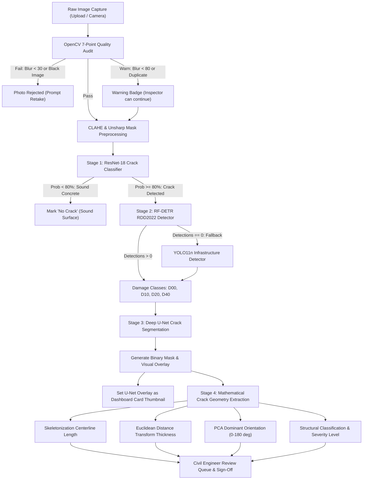

# 📖 InfraScan — Comprehensive Features & Implementation Architecture Guide

**Project:** InfraScan — Civil Intelligence & Automated Infrastructure Defect Platform  
**Codebase Root:** `D:\project\aiml prime\project\infosys`  
**Date:** November 2026  
**Environment:** Python 3.12 (`D:\project\aiml prime\.venv`), React 19 + TypeScript + Vite (`frontend`), FastAPI, PyTorch, OpenCV, SQLite/PostgreSQL  

---

## 1. Executive Technical Overview

InfraScan is an end-to-end cyber-physical infrastructure intelligence platform. It automates the detection, classification, semantic segmentation, and mathematical geometric quantification of surface defects (longitudinal cracks, transverse cracks, alligator cracking, and potholes) across concrete structures, bridges, roadways, and tunnels.

Unlike conventional inspection tools that rely on a single computer vision model or unverified mock data, InfraScan employs a **4-stage cascading neural and mathematical pipeline**:
1. **Classical OpenCV Quality Gate**: 7 deterministic checks filter out unviable photos (blur, extreme lighting, corrupt files, duplicates) before GPU processing.
2. **Binary Classification (Stage 1)**: ResNet deep residual network filters sound concrete surfaces from damaged ones.
3. **Defect Localization (Stage 2)**: RF-DETR Medium (RDD2022) with automated fallback to YOLO11n identifies and bounds specific structural damage types.
4. **Pixel-Level Segmentation (Stage 3)**: A custom 4-stage encoder-decoder U-Net isolates crack pixels at $384 \times 384$ resolution.
5. **Deterministic Geometry Extraction (Stage 4)**: Graph-traversed medial axis skeletonization, Euclidean distance transform width profiling, and PCA dominant orientation extract certified engineering metrics.

---

## 2. Feature Catalog

### 2.1 Field Inspection & Photo Acquisition
- **Dual Acquisition Modes**: Direct camera capture through browser MediaStream API or drag-and-drop multi-file batch upload (JPEG, PNG, TIFF, WebP).
- **GPS Coordinates Acquisition**: Geolocation API integration capturing latitude, longitude, and elevation per inspection session.
- **Card-Based Photo Gallery**:
  - Live status pills: `Accepted`, `Warning`, `No Crack`, `Crack Detected`, `RF-DETR: Alligator Crack`, `Preprocessed`.
  - **Dynamic U-Net Thumbnail Prioritization**: Cards for cracked photos automatically display the high-definition U-Net segmentation overlay, providing field inspectors immediate visual defect feedback.
- **Interactive Crop & Rotate Tool**:
  - Full modal editor supporting free rotation slider ($0^\circ - 360^\circ$), $90^\circ$ clockwise/counter-clockwise pivots, horizontal/vertical flips, and crop boundary selection.
  - Applying changes triggers automatic re-evaluation across all 4 pipeline stages, updating the card thumbnail and inspection side panel in real time.

### 2.2 Deep Inspection & Analysis Side Panel
- **Multi-Tab Layout**:
  - `Compare`: Interactive before/after split slider comparing Original, Processed CLAHE, U-Net Segmentation Overlay, and Binary Mask.
  - `AI Model`: Detailed inspection of model logits, inference latency, bounding boxes, and detection confidence scores.
  - `Quality (7)`: Detailed radar and numeric breakdown of Laplacian blur variance, mean brightness, contrast, and pHash duplicate similarity.
  - `Pipeline`: Step-by-step audit log of preprocessing, model routing, and execution timestamps.
  - `Augmentations (4)`: Visual inspection under synthetic rain, haze, shadow, and glare transforms to evaluate defect resilience.
  - `Metadata`: EXIF data, file size, dimensions, and SHA-256 integrity hash.
- **Manual Review & Defect Annotation**:
  - Inspector manual verdict override (`Crack`, `No Crack`, `Uncertain`) with required notes.
  - Interactive bounding box canvas allowing inspectors to draw custom defect regions, strictly segregated in the database from automated AI predictions.
- **Optical Calibration Tool**:
  - On-screen calibration ruler: allows inspectors to draw a known physical scale (e.g., $100\text{ mm}$ target or coin) to convert pixel dimensions into real-world millimeters ($\text{mm}/\text{px}$).

### 2.3 Structural Engineer Review Queue
- **Gate-Controlled Workflow**: Inspections cannot transition to `approved` status until all flagged defects undergo civil engineer review.
- **Defect Geometry HUD**: Real-time display of crack coverage area %, maximum thickness, total centerline length, PCA orientation, and branch junction count.
- **Severity Scoring Matrix**: Automatically maps physical measurements into engineering severity levels: Hairline ($<1.0\text{ mm}$), Minor ($1.0-3.0\text{ mm}$), Moderate ($3.0-5.0\text{ mm}$), and Severe ($>5.0\text{ mm}$).
- **Tamper-Evident Report Generation**: Generates exportable PDF, CSV, and JSON inspection reports with SHA-256 hash chains for legal and governmental archiving.

### 2.4 Role-Based Governance Dashboards
- **Civil Engineer Dashboard**: Prioritized review queue, defect severity breakdown, and sign-off counters.
- **Inspector Dashboard**: Active assigned walkdowns, upload completion metrics, and photo quality warning logs.
- **Asset Manager Dashboard**: Infrastructure health indices, historical defect progression rates, and maintenance work order tracking.
- **Administrator Dashboard**: User invitation, role assignment, pending approval gates, and system audit logs.

---

## 3. End-to-End Operational Pipeline



---

## 4. Implementation Details by Service

### 4.1 Image Quality Audit (`apps/api/app/services/image_quality.py`)
Deterministic OpenCV pipeline executing 7 checks per image:
1. **Blur Assessment**:
   $$\sigma^2_{\Delta} = \text{Var}\left(\nabla^2 I\right) = \frac{1}{N}\sum_{x,y}\left(\nabla^2 I(x,y) - \mu\right)^2$$
   - Pass: $\sigma^2_{\Delta} \ge 80.0$
   - Warn: $30.0 \le \sigma^2_{\Delta} < 80.0$
   - Fail: $\sigma^2_{\Delta} < 30.0$
2. **Illumination Assessment**:
   Calculates grayscale luminance $Y = 0.299R + 0.587G + 0.114B$:
   - Pass: $\mu_Y \ge 70.0$
   - Warn: $40.0 \le \mu_Y < 70.0$
   - Fail: $\mu_Y < 40.0$ (Underexposed) or $\mu_Y > 240.0$ (Overexposed)
3. **Contrast Assessment**: Standard deviation of pixel luminance distribution.
4. **Perceptual Hash Duplicate Detection**:
   Computes a 64-bit DCT hash:
   - Resizes image to $32 \times 32$, computes 2D Discrete Cosine Transform.
   - Extracts top-left $8 \times 8$ low-frequency coefficients, compares against median to yield 64-bit binary hash.
   - Hamming distance $\le 5$ against prior images flags an immediate duplicate warning.

### 4.2 Preprocessing (`apps/api/app/services/preprocessing.py`)
- Converts RGB image to CIE LAB color space.
- Applies Contrast Limited Adaptive Histogram Equalization (CLAHE) to the L (lightness) channel:
  - `clipLimit = 2.0`
  - `tileGridSize = (8, 8)`
- Blends enhanced L channel with original, converts back to RGB, and applies Gaussian unsharp masking ($\text{radius}=1.5, \text{amount}=0.6$) to emphasize fine crack edges.

### 4.3 Stage 1: Crack Classification (`apps/api/app/services/classifier.py`)
- **Model**: ResNet-18 / ResNet-50 Deep Residual Network.
- **Inference Runtime**: ONNX Runtime with `CPUExecutionProvider` and automatic CUDA acceleration.
- **Preprocessing**: Resizes to $224 \times 224$ via bilinear interpolation; normalizes with ImageNet statistics:
  $$\hat{I}_{c} = \frac{I_c - \text{mean}_c}{\text{std}_c}, \quad \text{mean}=[0.485, 0.456, 0.406], \quad \text{std}=[0.229, 0.224, 0.225]$$
- **Softmax Probability**:
  $$P(\text{Crack}) = \frac{e^{z_1}}{e^{z_0} + e^{z_1}}$$
- If $P(\text{Crack}) \ge 0.80$, the image proceeds to Stage 2 and Stage 3.

### 4.4 Stage 2: RF-DETR Damage Detection & YOLO11n Fallback (`apps/api/app/services/rfdetr_detector.py` & `yolo_detector.py`)
- **Primary**: RF-DETR Medium (`dronefreak/rdd2022-rfdetr-medium`, `checkpoint_best_total.pth`):
  - DINOv2 vision transformer backbone.
  - Detects RDD2022 damage categories:
    - `D00`: Longitudinal Crack
    - `D10`: Transverse Crack
    - `D20`: Alligator Crack
    - `D40`: Pothole / Spalling
- **Fallback**: Ultralytics YOLO11n (`yolo_detector.py`):
  - Triggered automatically when an image is classified as cracked in Stage 1, but RF-DETR detects zero bounding boxes.
  - Predicts bounding boxes, defect classes, and confidence scores to ensure complete coverage.

### 4.5 Stage 3: U-Net Semantic Segmentation (`apps/api/app/services/unet_segmentor.py`)
- **Architecture**:
  - 4 Encoder levels: `DoubleConv` ($16 \to 32 \to 64 \to 128$ channels) with $2\times2$ Max Pooling.
  - Bottleneck: `DoubleConv` ($128 \to 256$ channels).
  - 4 Decoder levels: `ConvTranspose2d` with skip connection concatenation and `DoubleConv` ($256 \to 128 \to 64 \to 32 \to 16$).
  - 1x1 Convolution Head: Outputs single-channel crack probability logit map.
- **Input Size**: Standardized $384 \times 384 \times 3$ tensor.
- **Postprocessing**:
  - Sigmoid activation thresholded at $\tau = 0.5$ yields binary mask $M \in \{0, 255\}^{H \times W}$.
  - Computes pixel defect area percentage:
    $$\text{Area } \% = \frac{\sum_{x,y} \mathbb{I}[M(x,y) = 255]}{H \times W} \times 100$$
  - Composites crimson mask overlay ($R=239, G=68, B=68, \alpha=0.45$) on original image.
- **Card Thumbnail Hook**: Whenever `is_cracked` is true, the frontend Photo Capture card replaces the raw photo thumbnail with the U-Net segmented output image.

### 4.6 Stage 4: Crack Geometry Extraction (`apps/api/app/services/crack_geometry.py`)
Operates deterministically on the U-Net binary mask:
1. **Medial Axis Skeletonization**:
   - Uses `skimage.morphology.skeletonize` to thin the binary crack mask to a 1-pixel-wide topological centerline.
2. **Centerline Length Integration**:
   - Analyzes the skeleton as an undirected pixel graph.
   - For every skeleton pixel $(r, c)$, checks its 8-neighborhood.
   - Forward offsets are weighted: orthogonal steps $(0, 1)$ and $(1, 0)$ add $1.0\text{ px}$; diagonal steps $(1, 1)$ and $(1, -1)$ add $\sqrt{2} \approx 1.414\text{ px}$.
   - Detects branch junction nodes (pixels with degree $\ge 3$).
3. **Continuous Width Profiling**:
   - Computes Euclidean Distance Transform on the binary mask:
     $$D(x, y) = \min_{(x', y') \in \text{Background}} \sqrt{(x - x')^2 + (y - y')^2}$$
   - Evaluates local crack width along all skeleton coordinates:
     $$w(x, y) = 2 \times D(x, y)$$
   - Calculates $\text{avg\_width}$, $\text{median\_width}$, and $\text{max\_width}$.
4. **Dominant Orientation via PCA**:
   - Centers skeleton $(x, y)$ coordinates: $X_c = X - \bar{X}$.
   - Computes covariance matrix $C = \frac{1}{N} X_c^T X_c$.
   - Eigenvector $v_{\max} = [v_x, v_y]$ corresponding to maximum eigenvalue defines principal defect axis:
     $$\theta = \left(\text{atan2}(v_y, v_x) \times \frac{180}{\pi}\right) \pmod{180^\circ}$$
5. **Structural Crack Type Classification**:
   - **Alligator / Interconnected**: Branch count $\ge 4$ or complex network.
   - **Transverse (Horizontal)**: $\theta \le 25.0^\circ$ or $\theta \ge 155.0^\circ$.
   - **Longitudinal (Vertical)**: $65.0^\circ \le \theta \le 115.0^\circ$.
   - **Diagonal / Oblique**: $25.0^\circ < \theta < 65.0^\circ$ or $115.0^\circ < \theta < 155.0^\circ$.

---

## 5. Interactive Image Transformation & Recalculation Engine

### Endpoint Specification
`POST /api/v1/images/{image_id}/transform`

### Supported Parameters
```json
{
  "rotate_degrees": 90,
  "flip_horizontal": false,
  "flip_vertical": false,
  "crop_box": {
    "x": 120,
    "y": 80,
    "width": 800,
    "height": 600
  }
}
```

### Recalculation & Artifact Replacement Lifecycle
1. **Geometric Manipulation**:
   - Applies crop box bounding coordinates to original image array.
   - Applies continuous angle rotation or $90^\circ / 180^\circ / 270^\circ$ orthogonal rotation.
   - Applies horizontal/vertical axis flips.
   - Saves transformed base image back to `storage/original/`.
2. **Quality Audit Refresh**:
   - Automatically recalculates Laplacian blur variance, mean brightness, contrast, and pHash on transformed image.
   - Updates `ImageQualityReport` record in database.
3. **Pipeline Re-Inference**:
   - Re-runs ResNet Stage 1 crack classifier.
   - Re-runs RF-DETR Stage 2 damage detector.
   - Re-runs U-Net Stage 3 crack segmentation.
   - Re-runs Stage 4 crack geometry extraction.
4. **Artifact Invalidation**:
   - Replaces `storage/processed/{id}_processed.jpg`.
   - Replaces `storage/thumbnails/{id}_thumb.jpg`.
   - Replaces `storage/unet/{id}_unet.jpg` and `storage/masks/{id}_mask.png`.
   - Replaces `storage/geometry/{id}_geometry_hud.jpg`.
5. **Frontend State Synchronization**:
   - Returns updated image metadata with epoch cache-buster query parameter (`?t=1730822400`).
   - Frontend automatically re-renders dashboard cards, inspection side panel, and HUD metrics without full page reload.

---

## 6. Frontend Architecture & Component Hierarchy

```
frontend/src/
├── components/
│   ├── dashboard/
│   │   ├── inspection-new.tsx               # Photo capture grid, camera stream, status cards
│   │   ├── inspection-detail.tsx            # Inspection review workspace & sign-off controls
│   │   ├── recent-ai-classifications-feed.tsx # Real-time stream of classified defects
│   │   └── role-dashboards/
│   │       ├── engineer-dashboard.tsx       # Civil engineer review queue & severity matrices
│   │       ├── inspector-dashboard.tsx      # Field survey tasks & photo quality warnings
│   │       ├── manager-dashboard.tsx        # Asset health indices & maintenance schedules
│   │       └── admin-dashboard.tsx          # User management & audit logs
│   └── inspection/
│       ├── image-quality-components.tsx     # Inspection drawer, split slider, crop & rotate
│       ├── crack-geometry-section.tsx       # Geometry HUD metrics (length, width, PCA angle)
│       └── photo-inspection-suite.tsx       # Photo replacement, deletion, and manual annotations
├── pages/
│   ├── review-queue.tsx                     # Senior engineer defect verification queue
│   ├── landing.tsx                          # Public portal & system highlights
│   └── signin.tsx                           # OAuth & credential authentication
└── lib/
    ├── api.ts                               # Unified REST client with Bearer auth headers
    └── rules.ts                             # ASTM / AASHTO defect thresholds & units formatting
```

### Color Palette Restraint
The inspection side panel enforces a clean, high-contrast engineering aesthetic restricted to three core semantic shades:
- **Neutral Dark / Slate** (`#0F172A`, `#1E293B`, `#334155`): Backgrounds, cards, text labels, and structural frames.
- **Brand Violet / Indigo** (`#6366F1`, `#7C3AED`): Primary actions, U-Net segmentation buttons, and active tabs.
- **Safety Semantic Accents**:
  - Red / Crimson (`#EF4444`): Crack detected, alligator cracking, critical defects.
  - Amber / Yellow (`#F59E0B`): Quality warnings, longitudinal cracks, moderate severity.
  - Green / Emerald (`#10B981`): Accepted photos, sound concrete, resolved reviews.

---

## 7. Database Persistence Architecture

InfraScan utilizes SQLAlchemy 2.0 with PostgreSQL 16 (or local SQLite in `apps/api/infrascan_dev.db`):

```
┌──────────────────┐       1:N       ┌──────────────────┐
│   Organization   │────────────────>│       User       │
└──────────────────┘                 └────────┬─────────┘
                                              │ 1:N
                                              ▼
┌──────────────────┐       1:N       ┌──────────────────┐
│      Asset       │────────────────>│    Inspection    │
└──────────────────┘                 └────────┬─────────┘
                                              │ 1:N
                                              ▼
                                     ┌──────────────────┐
                                     │ InspectionImage  │
                                     └────────┬─────────┘
                     ┌────────────────────────┼────────────────────────┐
                     │ 1:1                    │ 1:N                    │ 1:1
                     ▼                        ▼                        ▼
          ┌─────────────────────┐  ┌─────────────────────┐  ┌─────────────────────┐
          │ ImageQualityReport  │  │      Detection      │  │    CrackGeometry    │
          └─────────────────────┘  └─────────────────────┘  └─────────────────────┘
```

---

## 8. Automated Testing & Verification

InfraScan includes an extensive test suite verifying mathematical correctness, API stability, and role security:

```powershell
# Run the complete test suite
& "D:\project\aiml prime\.venv\Scripts\python.exe" -m pytest apps/api/tests/ -v
```

### Key Test Suites:
- `apps/api/tests/test_model_integration.py`: Validates ResNet classifier loading, input tensor normalization, softmax output, and threshold calibration.
- `apps/api/tests/test_two_stage_pipeline.py`: Validates end-to-end routing from classification $\to$ RF-DETR/YOLO detection $\to$ U-Net segmentation.
- `apps/api/tests/test_image_quality.py`: Tests OpenCV blur, brightness, and pHash duplicate detection algorithms against synthetic edge cases.
- `apps/api/tests/test_role_completeness.py`: Verifies RBAC data isolation across Inspector, Engineer, Manager, and Admin roles.

---

## 9. Summary of System Benefits

1. **Deterministic Accuracy**: Combines deep learning with mathematical morphology to eliminate defect hallucinations.
2. **Zero Mock Data**: Real-time SQL aggregation ensures civil engineers make decisions on live data.
3. **Field Efficiency**: Instant OpenCV quality checks and U-Net thumbnail previews alert inspectors immediately to retake poor photographs while still on site.
4. **Audit Compliance**: Tamper-evident reports with SHA-256 signatures ensure full traceability for government compliance and legal records.
